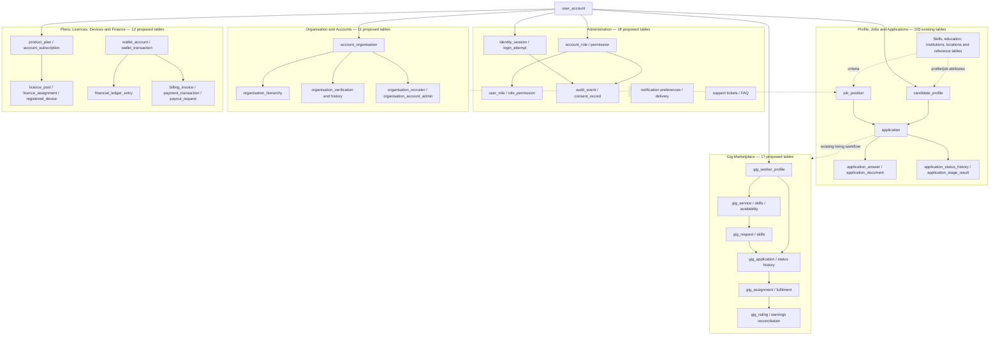

# Talentra Database Schema Reference

> PostgreSQL schema reference for the Talentra Database Design Hackathon. This document intentionally excludes `neon_auth` and all `neon_auth.*` entities. Entity details are presented as Markdown tables, not SQL queries.

## 1. Module-wise table inventory

| No. | Module | Table count | Inventory status |
|---:|---|---:|---|
| 1 | Profile, Jobs and Applications | 103 | Existing tables supplied in the schema inventory; column export was truncated |
| 2 | Administration | 18 | Proposed extension tables documented below |
| 3 | Organisation and Accounts | 11 | Proposed extension tables documented below |
| 4 | Gig Marketplace | 17 | Proposed extension tables documented below |
| 5 | Plans, Licences, Devices and Finance | 12 | Proposed extension tables documented below |
| | **Total** | **161** | **103 existing + 58 proposed extension tables** |

Counts are table inventory counts, not a claim that every proposed table has already been deployed. The existing inventory includes supporting/reference tables (for example country, currency, skill, status and translation tables) as well as profile, job and application tables.

## 2. Architecture and relationship overview

The diagram below shows the major modules and their key relationship paths. The detailed extension-table definitions later in this document specify individual columns, primary keys, foreign keys, unique constraints, checks and defaults. Existing-table relationships are shown at module level where the supplied export does not expose reliable column definitions.

### Relationship conventions

- **PK** identifies each table's primary key; most proposed extension tables use an identity `BIGINT` primary key named `id`.
- **FK** marks a relationship to another table. The proposed table definitions show the foreign-key relationships captured in the draft schema.
- **1-to-many** means one parent record may be referenced by multiple child records (for example a job position and its applications).
- **Many-to-many** relationships are represented by junction tables such as `role_permission`, `user_role`, `gig_service_skill` and `gig_request_skill`.
- The diagram is a module-level architecture view; individual table rows document the known relationships.

---

## Scope and important notes

- This document describes **58 proposed extension tables** using Markdown tables for columns, keys, defaults, and constraints. No SQL queries are included.
- Existing Talentra tables are listed separately below because the uploaded existing-column export was truncated; their complete column definitions cannot be reliably documented from that export.
- Foreign keys to existing tables assume those tables and referenced key columns exist in the target database. Verify types and key names before applying migrations.
- Timestamps use `TIMESTAMPTZ`; money amounts use the types defined in SQL and should always be interpreted with their currency field.

## Existing Talentra entities (not recreated here)

These tables were present in the supplied schema inventory. Their columns and constraints are intentionally not guessed.

- `academic_program`, `accomplishment_type`, `activity_type`, `application`
- `application_answer`, `application_document`, `application_profile_snapshot`, `application_stage_result`
- `application_status`, `application_status_history`, `application_withdrawal`, `assessment`
- `assessment_result`, `candidate_academic_result`, `candidate_accomplishment`, `candidate_activity_log`
- `candidate_activity_type`, `candidate_backlog`, `candidate_bookmark`, `candidate_bookmark_history`
- `candidate_contact`, `candidate_document`, `candidate_education`, `candidate_experience`
- `candidate_extracurricular_activity`, `candidate_job_eligibility_check`, `candidate_job_search_history`, `candidate_language`
- `candidate_profile`, `candidate_project`, `candidate_skill`, `candidate_social_link`
- `candidate_subject`, `candidate_volunteer_experience`, `city`, `country`
- `course`, `course_enrolment`, `course_enrolment_status`, `currency`
- `document_type`, `education_level`, `education_verification`, `eligibility_check_result`
- `eligibility_decision`, `employment_type`, `experience_type`, `hiring_stage_type`
- `industry`, `institution`, `interview`, `interview_status`
- `job_academic_criterion`, `job_application_policy`, `job_attachment`, `job_eligibility_policy`
- `job_eligible_program`, `job_event`, `job_event_type`, `job_external_ats`
- `job_hiring_stage`, `job_location`, `job_position`, `job_position_status`
- `job_qualification_requirement`, `job_requirement`, `job_role`, `job_shortlist`
- `job_skill_requirement`, `job_status`, `job_status_history`, `joining_record`
- `language`, `offer`, `offer_status`, `organisation`
- `proficiency_level`, `profile_completion_score`, `profile_view_history`, `qualification`
- `question`, `question_option`, `question_type`, `questionnaire`
- `reference_code`, `reference_translation`, `referral_status`, `referral_tracking`
- `resume_template`, `resume_version`, `salary_period`, `score_scale`
- `shortlist_history`, `skill`, `social_platform`, `stage_decision`
- `state`, `subject`, `ui_translation`, `user_account`
- `verification_status`, `withdrawal_outcome`, `work_type`

## Proposed extension entities: columns and constraints

### Administration & access control

#### `account_role`

#### `account_role`

| Column | Data type | Key / relationship | Constraints / default |
|---|---|---|---|
| id | BIGINT | PK | — |
| role_code | VARCHAR(60) | UNIQUE | NOT NULL |
| role_name | VARCHAR(120) | — | NOT NULL |
| description | TEXT | — | — |
| is_system_role | BOOLEAN | — | NOT NULL; DEFAULT FALSE |
| is_active | BOOLEAN | — | NOT NULL; DEFAULT TRUE |
| sort_order | INTEGER | — | NOT NULL; DEFAULT 0 |
| created_at | TIMESTAMPTZ | — | NOT NULL; DEFAULT now() |
| created_by | BIGINT | FK: user_account(id) | — |
| updated_at | TIMESTAMPTZ | — | NOT NULL; DEFAULT now() |
| updated_by | BIGINT | FK: user_account(id) | — |

#### `permission`

#### `permission`

| Column | Data type | Key / relationship | Constraints / default |
|---|---|---|---|
| id | BIGINT | PK | — |
| permission_code | VARCHAR(120) | UNIQUE | NOT NULL |
| permission_name | VARCHAR(150) | — | NOT NULL |
| module_code | VARCHAR(60) | — | NOT NULL |
| description | TEXT | — | — |
| is_sensitive | BOOLEAN | — | NOT NULL; DEFAULT FALSE |
| is_active | BOOLEAN | — | NOT NULL; DEFAULT TRUE |
| created_at | TIMESTAMPTZ | — | NOT NULL; DEFAULT now() |
| created_by | BIGINT | FK: user_account(id) | — |
| updated_at | TIMESTAMPTZ | — | NOT NULL; DEFAULT now() |
| updated_by | BIGINT | FK: user_account(id) | — |

#### `role_permission`

#### `role_permission`

| Column | Data type | Key / relationship | Constraints / default |
|---|---|---|---|
| id | BIGINT | PK | — |
| account_role_id | BIGINT | FK: account_role(id) | NOT NULL |
| permission_id | BIGINT | FK: permission(id) | NOT NULL |
| granted_at | TIMESTAMPTZ | — | NOT NULL; DEFAULT now() |
| granted_by | BIGINT | FK: user_account(id) | — |

**Table-level constraints**

| Constraint | Definition |
|---|---|
| Constraint 1 | `UNIQUE (account_role_id, permission_id)` |

#### `user_role`

#### `user_role`

| Column | Data type | Key / relationship | Constraints / default |
|---|---|---|---|
| id | BIGINT | PK | — |
| user_account_id | BIGINT | FK: user_account(id) | NOT NULL |
| account_role_id | BIGINT | FK: account_role(id) | NOT NULL |
| scope_type | VARCHAR(30) | — | NOT NULL; DEFAULT 'GLOBAL' |
| scope_organisation_id | BIGINT | — | — |
| valid_from | TIMESTAMPTZ | — | NOT NULL; DEFAULT now() |
| valid_until | TIMESTAMPTZ | — | — |
| assigned_by | BIGINT | FK: user_account(id) | — |
| assignment_reason | TEXT | — | — |
| created_at | TIMESTAMPTZ | — | NOT NULL; DEFAULT now() |

**Table-level constraints**

| Constraint | Definition |
|---|---|
| Constraint 1 | `CHECK (valid_until IS NULL OR valid_until > valid_from)` |

#### `user_credential`

#### `user_credential`

| Column | Data type | Key / relationship | Constraints / default |
|---|---|---|---|
| id | BIGINT | PK | — |
| user_account_id | BIGINT | FK: user_account(id) | NOT NULL |
| credential_type | VARCHAR(30) | — | NOT NULL |
| credential_identifier | VARCHAR(254) | — | NOT NULL |
| secret_hash | TEXT | — | — |
| secret_reference | TEXT | — | — |
| is_primary | BOOLEAN | — | NOT NULL; DEFAULT FALSE |
| verified_at | TIMESTAMPTZ | — | — |
| expires_at | TIMESTAMPTZ | — | — |
| last_used_at | TIMESTAMPTZ | — | — |
| failed_attempt_count | INTEGER | — | NOT NULL; DEFAULT 0; CHECK (failed_attempt_count >= 0) |
| locked_until | TIMESTAMPTZ | — | — |
| created_at | TIMESTAMPTZ | — | NOT NULL; DEFAULT now() |
| updated_at | TIMESTAMPTZ | — | NOT NULL; DEFAULT now() |

**Table-level constraints**

| Constraint | Definition |
|---|---|
| Constraint 1 | `UNIQUE (credential_type, credential_identifier)` |

#### `identity_session`

#### `identity_session`

| Column | Data type | Key / relationship | Constraints / default |
|---|---|---|---|
| id | BIGINT | PK | — |
| user_account_id | BIGINT | FK: user_account(id) | NOT NULL |
| session_token_hash | TEXT | UNIQUE | NOT NULL |
| device_id | BIGINT | — | — |
| ip_address | INET | — | — |
| user_agent | TEXT | — | — |
| source_timezone | VARCHAR(60) | — | — |
| started_at | TIMESTAMPTZ | — | NOT NULL; DEFAULT now() |
| last_activity_at | TIMESTAMPTZ | — | NOT NULL; DEFAULT now() |
| expires_at | TIMESTAMPTZ | — | NOT NULL |
| ended_at | TIMESTAMPTZ | — | — |
| end_reason | VARCHAR(40) | — | — |
| session_status | VARCHAR(30) | — | NOT NULL; DEFAULT 'ACTIVE' |
| created_at | TIMESTAMPTZ | — | NOT NULL; DEFAULT now() |

**Table-level constraints**

| Constraint | Definition |
|---|---|
| Constraint 1 | `CHECK (expires_at > started_at)` |
| Constraint 2 | `CHECK (ended_at IS NULL OR ended_at >= started_at)` |

#### `login_attempt`

#### `login_attempt`

| Column | Data type | Key / relationship | Constraints / default |
|---|---|---|---|
| id | BIGINT | PK | — |
| user_account_id | BIGINT | FK: user_account(id) | — |
| login_identifier | VARCHAR(254) | — | NOT NULL |
| attempted_at | TIMESTAMPTZ | — | NOT NULL; DEFAULT now() |
| ip_address | INET | — | — |
| user_agent | TEXT | — | — |
| attempt_result | VARCHAR(30) | — | NOT NULL |
| failure_reason_code | VARCHAR(50) | — | — |
| correlation_id | UUID | — | — |
| created_at | TIMESTAMPTZ | — | NOT NULL; DEFAULT now() |

#### `consent_record`

#### `consent_record`

| Column | Data type | Key / relationship | Constraints / default |
|---|---|---|---|
| id | BIGINT | PK | — |
| user_account_id | BIGINT | FK: user_account(id) | NOT NULL |
| consent_type | VARCHAR(60) | — | NOT NULL |
| policy_version | VARCHAR(40) | — | NOT NULL |
| consent_status | VARCHAR(20) | — | NOT NULL |
| captured_at | TIMESTAMPTZ | — | NOT NULL; DEFAULT now() |
| withdrawn_at | TIMESTAMPTZ | — | — |
| capture_method | VARCHAR(40) | — | — |
| source_ip | INET | — | — |
| evidence_reference | TEXT | — | — |
| created_at | TIMESTAMPTZ | — | NOT NULL; DEFAULT now() |

**Table-level constraints**

| Constraint | Definition |
|---|---|
| Constraint 1 | `CHECK (consent_status IN ('GRANTED', 'DENIED', 'WITHDRAWN'))` |

#### `account_status_history`

#### `account_status_history`

| Column | Data type | Key / relationship | Constraints / default |
|---|---|---|---|
| id | BIGINT | PK | — |
| user_account_id | BIGINT | FK: user_account(id) | NOT NULL |
| previous_status | VARCHAR(30) | — | — |
| new_status | VARCHAR(30) | — | NOT NULL |
| change_reason | TEXT | — | — |
| changed_by | BIGINT | FK: user_account(id) | — |
| changed_at | TIMESTAMPTZ | — | NOT NULL; DEFAULT now() |

#### `audit_event`

#### `audit_event`

| Column | Data type | Key / relationship | Constraints / default |
|---|---|---|---|
| id | BIGINT | PK | — |
| actor_user_account_id | BIGINT | FK: user_account(id) | — |
| action_code | VARCHAR(100) | — | NOT NULL |
| entity_type | VARCHAR(100) | — | NOT NULL |
| entity_id | BIGINT | — | — |
| outcome | VARCHAR(30) | — | NOT NULL |
| occurred_at | TIMESTAMPTZ | — | NOT NULL; DEFAULT now() |
| ip_address | INET | — | — |
| user_agent | TEXT | — | — |
| correlation_id | UUID | — | — |
| request_id | VARCHAR(100) | — | — |
| reason | TEXT | — | — |
| before_data | JSONB | — | — |
| after_data | JSONB | — | — |
| metadata | JSONB | — | NOT NULL; DEFAULT '{}'::jsonb |

#### `system_error_log`

#### `system_error_log`

| Column | Data type | Key / relationship | Constraints / default |
|---|---|---|---|
| id | BIGINT | PK | — |
| error_code | VARCHAR(100) | — | — |
| severity | VARCHAR(20) | — | NOT NULL |
| service_name | VARCHAR(100) | — | — |
| operation_name | VARCHAR(150) | — | — |
| message | TEXT | — | NOT NULL |
| stack_reference | TEXT | — | — |
| correlation_id | UUID | — | — |
| occurred_at | TIMESTAMPTZ | — | NOT NULL; DEFAULT now() |
| resolved_at | TIMESTAMPTZ | — | — |
| resolution_note | TEXT | — | — |

#### `user_block`

#### `user_block`

| Column | Data type | Key / relationship | Constraints / default |
|---|---|---|---|
| id | BIGINT | PK | — |
| blocker_user_account_id | BIGINT | FK: user_account(id) | NOT NULL |
| blocked_user_account_id | BIGINT | FK: user_account(id) | — |
| blocked_organisation_id | BIGINT | FK: organisation(id) | — |
| block_reason | VARCHAR(60) | — | — |
| notes | TEXT | — | — |
| blocked_at | TIMESTAMPTZ | — | NOT NULL; DEFAULT now() |
| unblocked_at | TIMESTAMPTZ | — | — |
| created_at | TIMESTAMPTZ | — | NOT NULL; DEFAULT now() |

**Table-level constraints**

| Constraint | Definition |
|---|---|
| Constraint 1 | `CHECK (blocker_user_account_id <> blocked_user_account_id)` |
| Constraint 2 | `CHECK (num_nonnulls(blocked_user_account_id, blocked_organisation_id) = 1)` |

#### `user_preference`

#### `user_preference`

| Column | Data type | Key / relationship | Constraints / default |
|---|---|---|---|
| id | BIGINT | PK | — |
| user_account_id | BIGINT | FK: user_account(id) | NOT NULL |
| preference_key | VARCHAR(100) | — | NOT NULL |
| preference_value | JSONB | — | NOT NULL |
| updated_at | TIMESTAMPTZ | — | NOT NULL; DEFAULT now() |

**Table-level constraints**

| Constraint | Definition |
|---|---|
| Constraint 1 | `UNIQUE(user_account_id, preference_key)` |

#### `notification_preference`

#### `notification_preference`

| Column | Data type | Key / relationship | Constraints / default |
|---|---|---|---|
| id | BIGINT | PK | — |
| user_account_id | BIGINT | FK: user_account(id) | NOT NULL |
| channel_code | VARCHAR(30) | — | NOT NULL |
| notification_category | VARCHAR(60) | — | NOT NULL |
| is_enabled | BOOLEAN | — | NOT NULL; DEFAULT TRUE |
| quiet_hours_start | TIME | — | — |
| quiet_hours_end | TIME | — | — |
| timezone_name | VARCHAR(60) | — | — |
| updated_at | TIMESTAMPTZ | — | NOT NULL; DEFAULT now() |

**Table-level constraints**

| Constraint | Definition |
|---|---|
| Constraint 1 | `UNIQUE(user_account_id, channel_code, notification_category)` |

#### `notification_delivery`

#### `notification_delivery`

| Column | Data type | Key / relationship | Constraints / default |
|---|---|---|---|
| id | BIGINT | PK | — |
| user_account_id | BIGINT | FK: user_account(id) | NOT NULL |
| notification_type | VARCHAR(60) | — | NOT NULL |
| channel_code | VARCHAR(30) | — | NOT NULL |
| provider_name | VARCHAR(80) | — | — |
| provider_message_reference | VARCHAR(200) | — | — |
| delivery_status | VARCHAR(30) | — | NOT NULL; DEFAULT 'QUEUED' |
| queued_at | TIMESTAMPTZ | — | NOT NULL; DEFAULT now() |
| sent_at | TIMESTAMPTZ | — | — |
| delivered_at | TIMESTAMPTZ | — | — |
| failed_at | TIMESTAMPTZ | — | — |
| failure_code | VARCHAR(80) | — | — |
| retry_count | INTEGER | — | NOT NULL; DEFAULT 0; CHECK (retry_count >= 0) |
| correlation_id | UUID | — | — |

#### `support_ticket`

#### `support_ticket`

| Column | Data type | Key / relationship | Constraints / default |
|---|---|---|---|
| id | BIGINT | PK | — |
| ticket_number | VARCHAR(40) | UNIQUE | NOT NULL |
| requester_user_account_id | BIGINT | FK: user_account(id) | NOT NULL |
| assigned_user_account_id | BIGINT | FK: user_account(id) | — |
| subject | VARCHAR(200) | — | NOT NULL |
| description | TEXT | — | NOT NULL |
| category_code | VARCHAR(60) | — | — |
| priority | VARCHAR(20) | — | NOT NULL; DEFAULT 'NORMAL' |
| ticket_status | VARCHAR(30) | — | NOT NULL; DEFAULT 'OPEN' |
| opened_at | TIMESTAMPTZ | — | NOT NULL; DEFAULT now() |
| resolved_at | TIMESTAMPTZ | — | — |
| closed_at | TIMESTAMPTZ | — | — |
| created_at | TIMESTAMPTZ | — | NOT NULL; DEFAULT now() |
| updated_at | TIMESTAMPTZ | — | NOT NULL; DEFAULT now() |

#### `support_ticket_message`

#### `support_ticket_message`

| Column | Data type | Key / relationship | Constraints / default |
|---|---|---|---|
| id | BIGINT | PK | — |
| support_ticket_id | BIGINT | FK: support_ticket(id) | NOT NULL |
| author_user_account_id | BIGINT | FK: user_account(id) | NOT NULL |
| message_body | TEXT | — | NOT NULL |
| is_internal | BOOLEAN | — | NOT NULL; DEFAULT FALSE |
| created_at | TIMESTAMPTZ | — | NOT NULL; DEFAULT now() |

#### `faq_article`

#### `faq_article`

| Column | Data type | Key / relationship | Constraints / default |
|---|---|---|---|
| id | BIGINT | PK | — |
| faq_code | VARCHAR(60) | UNIQUE | NOT NULL |
| category_code | VARCHAR(60) | — | — |
| language_code | VARCHAR(10) | — | NOT NULL; DEFAULT 'en' |
| question | TEXT | — | NOT NULL |
| answer | TEXT | — | NOT NULL |
| is_published | BOOLEAN | — | NOT NULL; DEFAULT FALSE |
| sort_order | INTEGER | — | NOT NULL; DEFAULT 0 |
| created_at | TIMESTAMPTZ | — | NOT NULL; DEFAULT now() |
| created_by | BIGINT | FK: user_account(id) | — |
| updated_at | TIMESTAMPTZ | — | NOT NULL; DEFAULT now() |
| updated_by | BIGINT | FK: user_account(id) | — |

### Organisation & account management

#### `account_profile`

#### `account_profile`

| Column | Data type | Key / relationship | Constraints / default |
|---|---|---|---|
| id | BIGINT | PK | — |
| account_code | VARCHAR(60) | UNIQUE | NOT NULL |
| account_name | VARCHAR(200) | — | NOT NULL |
| account_type | VARCHAR(40) | — | NOT NULL |
| account_status | VARCHAR(30) | — | NOT NULL; DEFAULT 'PENDING' |
| primary_organisation_id | BIGINT | FK: organisation(id) | — |
| billing_email | VARCHAR(254) | — | — |
| preferred_language_code | VARCHAR(10) | — | NOT NULL; DEFAULT 'en' |
| timezone_name | VARCHAR(60) | — | — |
| created_at | TIMESTAMPTZ | — | NOT NULL; DEFAULT now() |
| created_by | BIGINT | FK: user_account(id) | — |
| updated_at | TIMESTAMPTZ | — | NOT NULL; DEFAULT now() |
| updated_by | BIGINT | FK: user_account(id) | — |
| deleted_at | TIMESTAMPTZ | — | — |

#### `account_organisation`

#### `account_organisation`

| Column | Data type | Key / relationship | Constraints / default |
|---|---|---|---|
| id | BIGINT | PK | — |
| account_profile_id | BIGINT | FK: account_profile(id) | NOT NULL |
| organisation_id | BIGINT | FK: organisation(id) | NOT NULL |
| relationship_type | VARCHAR(40) | — | NOT NULL; DEFAULT 'PRIMARY' |
| is_primary | BOOLEAN | — | NOT NULL; DEFAULT FALSE |
| valid_from | TIMESTAMPTZ | — | NOT NULL; DEFAULT now() |
| valid_until | TIMESTAMPTZ | — | — |
| created_at | TIMESTAMPTZ | — | NOT NULL; DEFAULT now() |
| created_by | BIGINT | FK: user_account(id) | — |

**Table-level constraints**

| Constraint | Definition |
|---|---|
| Constraint 1 | `CHECK (valid_until IS NULL OR valid_until > valid_from)` |
| Constraint 2 | `UNIQUE(account_profile_id, organisation_id, relationship_type)` |

#### `organisation_hierarchy`

#### `organisation_hierarchy`

| Column | Data type | Key / relationship | Constraints / default |
|---|---|---|---|
| id | BIGINT | PK | — |
| parent_organisation_id | BIGINT | FK: organisation(id) | NOT NULL |
| child_organisation_id | BIGINT | FK: organisation(id) | NOT NULL |
| relationship_type | VARCHAR(40) | — | NOT NULL; DEFAULT 'SUBSIDIARY' |
| valid_from | TIMESTAMPTZ | — | NOT NULL; DEFAULT now() |
| valid_until | TIMESTAMPTZ | — | — |
| created_at | TIMESTAMPTZ | — | NOT NULL; DEFAULT now() |
| created_by | BIGINT | FK: user_account(id) | — |

**Table-level constraints**

| Constraint | Definition |
|---|---|
| Constraint 1 | `CHECK (parent_organisation_id <> child_organisation_id)` |
| Constraint 2 | `CHECK (valid_until IS NULL OR valid_until > valid_from)` |
| Constraint 3 | `UNIQUE(parent_organisation_id, child_organisation_id, relationship_type)` |

#### `organisation_location`

#### `organisation_location`

| Column | Data type | Key / relationship | Constraints / default |
|---|---|---|---|
| id | BIGINT | PK | — |
| organisation_id | BIGINT | FK: organisation(id) | NOT NULL |
| location_name | VARCHAR(150) | — | — |
| location_type | VARCHAR(40) | — | NOT NULL |
| address_line_1 | VARCHAR(255) | — | — |
| address_line_2 | VARCHAR(255) | — | — |
| city_id | BIGINT | FK: city(id) | — |
| state_id | BIGINT | FK: state(id) | — |
| country_id | BIGINT | FK: country(id) | — |
| postal_code | VARCHAR(20) | — | — |
| latitude | NUMERIC(9,6) | — | — |
| longitude | NUMERIC(9,6) | — | — |
| is_headquarters | BOOLEAN | — | NOT NULL; DEFAULT FALSE |
| is_active | BOOLEAN | — | NOT NULL; DEFAULT TRUE |
| created_at | TIMESTAMPTZ | — | NOT NULL; DEFAULT now() |
| created_by | BIGINT | FK: user_account(id) | — |
| updated_at | TIMESTAMPTZ | — | NOT NULL; DEFAULT now() |
| updated_by | BIGINT | FK: user_account(id) | — |

**Table-level constraints**

| Constraint | Definition |
|---|---|
| Constraint 1 | `CHECK (latitude IS NULL OR latitude BETWEEN -90 AND 90)` |
| Constraint 2 | `CHECK (longitude IS NULL OR longitude BETWEEN -180 AND 180)` |

#### `organisation_identifier`

#### `organisation_identifier`

| Column | Data type | Key / relationship | Constraints / default |
|---|---|---|---|
| id | BIGINT | PK | — |
| organisation_id | BIGINT | FK: organisation(id) | NOT NULL |
| country_id | BIGINT | FK: country(id) | NOT NULL |
| identifier_type | VARCHAR(50) | — | NOT NULL |
| identifier_value_encrypted | TEXT | — | NOT NULL |
| identifier_fingerprint | VARCHAR(128) | — | NOT NULL |
| issued_by | VARCHAR(150) | — | — |
| valid_from | DATE | — | — |
| valid_until | DATE | — | — |
| verification_status | VARCHAR(30) | — | NOT NULL; DEFAULT 'PENDING' |
| created_at | TIMESTAMPTZ | — | NOT NULL; DEFAULT now() |
| created_by | BIGINT | FK: user_account(id) | — |
| updated_at | TIMESTAMPTZ | — | NOT NULL; DEFAULT now() |
| updated_by | BIGINT | FK: user_account(id) | — |

**Table-level constraints**

| Constraint | Definition |
|---|---|
| Constraint 1 | `UNIQUE(country_id, identifier_type, identifier_fingerprint)` |
| Constraint 2 | `CHECK (valid_until IS NULL OR valid_from IS NULL OR valid_until >= valid_from)` |

#### `organisation_verification`

#### `organisation_verification`

| Column | Data type | Key / relationship | Constraints / default |
|---|---|---|---|
| id | BIGINT | PK | — |
| organisation_id | BIGINT | FK: organisation(id) | NOT NULL |
| verification_type | VARCHAR(50) | — | NOT NULL |
| provider_name | VARCHAR(100) | — | — |
| provider_reference | VARCHAR(200) | — | — |
| outcome | VARCHAR(30) | — | NOT NULL; DEFAULT 'PENDING' |
| verification_token_reference | TEXT | — | — |
| requested_at | TIMESTAMPTZ | — | NOT NULL; DEFAULT now() |
| completed_at | TIMESTAMPTZ | — | — |
| expires_at | TIMESTAMPTZ | — | — |
| reviewed_by | BIGINT | FK: user_account(id) | — |
| review_notes | TEXT | — | — |
| created_at | TIMESTAMPTZ | — | NOT NULL; DEFAULT now() |

#### `organisation_verification_history`

#### `organisation_verification_history`

| Column | Data type | Key / relationship | Constraints / default |
|---|---|---|---|
| id | BIGINT | PK | — |
| organisation_verification_id | BIGINT | FK: organisation_verification(id) | NOT NULL |
| previous_outcome | VARCHAR(30) | — | — |
| new_outcome | VARCHAR(30) | — | NOT NULL |
| changed_by | BIGINT | FK: user_account(id) | — |
| change_reason | TEXT | — | — |
| changed_at | TIMESTAMPTZ | — | NOT NULL; DEFAULT now() |

#### `organisation_account_admin`

#### `organisation_account_admin`

| Column | Data type | Key / relationship | Constraints / default |
|---|---|---|---|
| id | BIGINT | PK | — |
| organisation_id | BIGINT | FK: organisation(id) | NOT NULL |
| user_account_id | BIGINT | FK: user_account(id) | NOT NULL |
| admin_type | VARCHAR(40) | — | NOT NULL; DEFAULT 'ACCOUNT_ADMIN' |
| is_primary | BOOLEAN | — | NOT NULL; DEFAULT FALSE |
| valid_from | TIMESTAMPTZ | — | NOT NULL; DEFAULT now() |
| valid_until | TIMESTAMPTZ | — | — |
| appointed_by | BIGINT | FK: user_account(id) | — |
| created_at | TIMESTAMPTZ | — | NOT NULL; DEFAULT now() |

**Table-level constraints**

| Constraint | Definition |
|---|---|
| Constraint 1 | `CHECK (valid_until IS NULL OR valid_until > valid_from)` |
| Constraint 2 | `UNIQUE(organisation_id, user_account_id, admin_type)` |

#### `organisation_recruiter`

#### `organisation_recruiter`

| Column | Data type | Key / relationship | Constraints / default |
|---|---|---|---|
| id | BIGINT | PK | — |
| organisation_id | BIGINT | FK: organisation(id) | NOT NULL |
| recruiter_user_account_id | BIGINT | FK: user_account(id) | NOT NULL |
| recruiter_type | VARCHAR(40) | — | NOT NULL; DEFAULT 'INTERNAL' |
| mapping_status | VARCHAR(30) | — | NOT NULL; DEFAULT 'ACTIVE' |
| valid_from | TIMESTAMPTZ | — | NOT NULL; DEFAULT now() |
| valid_until | TIMESTAMPTZ | — | — |
| mapped_by | BIGINT | FK: user_account(id) | — |
| mapping_reason | TEXT | — | — |
| created_at | TIMESTAMPTZ | — | NOT NULL; DEFAULT now() |

**Table-level constraints**

| Constraint | Definition |
|---|---|
| Constraint 1 | `CHECK (valid_until IS NULL OR valid_until > valid_from)` |

#### `organisation_status_history`

#### `organisation_status_history`

| Column | Data type | Key / relationship | Constraints / default |
|---|---|---|---|
| id | BIGINT | PK | — |
| organisation_id | BIGINT | FK: organisation(id) | NOT NULL |
| previous_status | VARCHAR(30) | — | — |
| new_status | VARCHAR(30) | — | NOT NULL |
| changed_by | BIGINT | FK: user_account(id) | — |
| reason | TEXT | — | — |
| changed_at | TIMESTAMPTZ | — | NOT NULL; DEFAULT now() |

#### `organisation_external_system`

#### `organisation_external_system`

| Column | Data type | Key / relationship | Constraints / default |
|---|---|---|---|
| id | BIGINT | PK | — |
| organisation_id | BIGINT | FK: organisation(id) | NOT NULL |
| system_code | VARCHAR(60) | — | NOT NULL |
| external_organisation_reference | VARCHAR(200) | — | NOT NULL |
| sync_direction | VARCHAR(20) | — | NOT NULL; DEFAULT 'INBOUND' |
| last_synced_at | TIMESTAMPTZ | — | — |
| sync_status | VARCHAR(30) | — | NOT NULL; DEFAULT 'PENDING' |
| last_error | TEXT | — | — |
| created_at | TIMESTAMPTZ | — | NOT NULL; DEFAULT now() |
| updated_at | TIMESTAMPTZ | — | NOT NULL; DEFAULT now() |

**Table-level constraints**

| Constraint | Definition |
|---|---|
| Constraint 1 | `UNIQUE(system_code, external_organisation_reference)` |

### Gig marketplace

#### `gig_worker_profile`

#### `gig_worker_profile`

| Column | Data type | Key / relationship | Constraints / default |
|---|---|---|---|
| id | BIGINT | PK | — |
| user_account_id | BIGINT | FK: user_account(id), UNIQUE | NOT NULL |
| candidate_profile_id | BIGINT | FK: candidate_profile(id) | — |
| worker_display_name | VARCHAR(150) | — | NOT NULL |
| worker_bio | TEXT | — | — |
| worker_status | VARCHAR(30) | — | NOT NULL; DEFAULT 'PENDING' |
| verification_status | VARCHAR(30) | — | NOT NULL; DEFAULT 'UNVERIFIED' |
| home_city_id | BIGINT | FK: city(id) | — |
| home_country_id | BIGINT | FK: country(id) | — |
| timezone_name | VARCHAR(60) | — | — |
| profile_visibility | VARCHAR(30) | — | NOT NULL; DEFAULT 'PUBLIC' |
| created_at | TIMESTAMPTZ | — | NOT NULL; DEFAULT now() |
| created_by | BIGINT | FK: user_account(id) | — |
| updated_at | TIMESTAMPTZ | — | NOT NULL; DEFAULT now() |
| updated_by | BIGINT | FK: user_account(id) | — |
| deleted_at | TIMESTAMPTZ | — | — |

#### `gig_service`

#### `gig_service`

| Column | Data type | Key / relationship | Constraints / default |
|---|---|---|---|
| id | BIGINT | PK | — |
| gig_worker_profile_id | BIGINT | FK: gig_worker_profile(id) | NOT NULL |
| service_code | VARCHAR(60) | — | — |
| service_title | VARCHAR(180) | — | NOT NULL |
| service_description | TEXT | — | — |
| industry_id | BIGINT | FK: industry(id) | — |
| base_rate | NUMERIC(14,2) | — | — |
| currency_code | CHAR(3) | — | NOT NULL |
| rate_period | VARCHAR(20) | — | NOT NULL; DEFAULT 'HOUR' |
| minimum_engagement_hours | NUMERIC(8,2) | — | — |
| is_active | BOOLEAN | — | NOT NULL; DEFAULT TRUE |
| created_at | TIMESTAMPTZ | — | NOT NULL; DEFAULT now() |
| updated_at | TIMESTAMPTZ | — | NOT NULL; DEFAULT now() |

**Table-level constraints**

| Constraint | Definition |
|---|---|
| Constraint 1 | `CHECK (base_rate IS NULL OR base_rate >= 0)` |
| Constraint 2 | `CHECK (minimum_engagement_hours IS NULL OR minimum_engagement_hours > 0)` |

#### `gig_service_skill`

#### `gig_service_skill`

| Column | Data type | Key / relationship | Constraints / default |
|---|---|---|---|
| id | BIGINT | PK | — |
| gig_service_id | BIGINT | FK: gig_service(id) | NOT NULL |
| skill_id | BIGINT | FK: skill(id) | NOT NULL |
| proficiency_level_code | VARCHAR(30) | — | — |
| created_at | TIMESTAMPTZ | — | NOT NULL; DEFAULT now() |

**Table-level constraints**

| Constraint | Definition |
|---|---|
| Constraint 1 | `UNIQUE(gig_service_id, skill_id)` |

#### `gig_worker_availability`

#### `gig_worker_availability`

| Column | Data type | Key / relationship | Constraints / default |
|---|---|---|---|
| id | BIGINT | PK | — |
| gig_worker_profile_id | BIGINT | FK: gig_worker_profile(id) | NOT NULL |
| available_from | TIMESTAMPTZ | — | NOT NULL |
| available_until | TIMESTAMPTZ | — | NOT NULL |
| availability_status | VARCHAR(30) | — | NOT NULL; DEFAULT 'AVAILABLE' |
| recurrence_rule | TEXT | — | — |
| timezone_name | VARCHAR(60) | — | NOT NULL |
| notes | TEXT | — | — |
| created_at | TIMESTAMPTZ | — | NOT NULL; DEFAULT now() |
| updated_at | TIMESTAMPTZ | — | NOT NULL; DEFAULT now() |

**Table-level constraints**

| Constraint | Definition |
|---|---|
| Constraint 1 | `CHECK (available_until > available_from)` |

#### `gig_request`

#### `gig_request`

| Column | Data type | Key / relationship | Constraints / default |
|---|---|---|---|
| id | BIGINT | PK | — |
| gig_code | VARCHAR(60) | UNIQUE | NOT NULL |
| requester_user_account_id | BIGINT | FK: user_account(id) | NOT NULL |
| requester_organisation_id | BIGINT | FK: organisation(id) | — |
| gig_title | VARCHAR(200) | — | NOT NULL |
| gig_description | TEXT | — | NOT NULL |
| service_category | VARCHAR(100) | — | — |
| gig_status | VARCHAR(30) | — | NOT NULL; DEFAULT 'DRAFT' |
| pricing_model | VARCHAR(20) | — | NOT NULL |
| price_amount | NUMERIC(14,2) | — | — |
| rate_amount | NUMERIC(14,2) | — | — |
| currency_code | CHAR(3) | — | NOT NULL |
| rate_period | VARCHAR(20) | — | — |
| expected_hours | NUMERIC(8,2) | — | — |
| start_window | TIMESTAMPTZ | — | NOT NULL |
| end_window | TIMESTAMPTZ | — | NOT NULL |
| location_type | VARCHAR(30) | — | NOT NULL; DEFAULT 'REMOTE' |
| city_id | BIGINT | FK: city(id) | — |
| country_id | BIGINT | FK: country(id) | — |
| is_consultant_open | BOOLEAN | — | NOT NULL; DEFAULT FALSE |
| application_deadline | TIMESTAMPTZ | — | — |
| external_fulfilment_required | BOOLEAN | — | NOT NULL; DEFAULT TRUE |
| created_at | TIMESTAMPTZ | — | NOT NULL; DEFAULT now() |
| created_by | BIGINT | FK: user_account(id) | — |
| updated_at | TIMESTAMPTZ | — | NOT NULL; DEFAULT now() |
| updated_by | BIGINT | FK: user_account(id) | — |
| deleted_at | TIMESTAMPTZ | — | — |

**Table-level constraints**

| Constraint | Definition |
|---|---|
| Constraint 1 | `CHECK (end_window > start_window)` |
| Constraint 2 | `CHECK (price_amount IS NULL OR price_amount >= 0)` |
| Constraint 3 | `CHECK (rate_amount IS NULL OR rate_amount >= 0)` |
| Constraint 4 | `CHECK (expected_hours IS NULL OR expected_hours > 0)` |
| Constraint 5 | `CHECK (pricing_model IN ('FIXED', 'RATE', 'NEGOTIABLE'))` |

#### `gig_request_skill`

#### `gig_request_skill`

| Column | Data type | Key / relationship | Constraints / default |
|---|---|---|---|
| id | BIGINT | PK | — |
| gig_request_id | BIGINT | FK: gig_request(id) | NOT NULL |
| skill_id | BIGINT | FK: skill(id) | NOT NULL |
| is_mandatory | BOOLEAN | — | NOT NULL; DEFAULT TRUE |
| minimum_proficiency_code | VARCHAR(30) | — | — |
| created_at | TIMESTAMPTZ | — | NOT NULL; DEFAULT now() |

**Table-level constraints**

| Constraint | Definition |
|---|---|
| Constraint 1 | `UNIQUE(gig_request_id, skill_id)` |

#### `gig_application`

#### `gig_application`

| Column | Data type | Key / relationship | Constraints / default |
|---|---|---|---|
| id | BIGINT | PK | — |
| gig_request_id | BIGINT | FK: gig_request(id) | NOT NULL |
| gig_worker_profile_id | BIGINT | FK: gig_worker_profile(id) | NOT NULL |
| application_status | VARCHAR(30) | — | NOT NULL; DEFAULT 'SUBMITTED' |
| proposed_price | NUMERIC(14,2) | — | — |
| currency_code | CHAR(3) | — | NOT NULL |
| proposed_rate | NUMERIC(14,2) | — | — |
| proposed_hours | NUMERIC(8,2) | — | — |
| availability_note | TEXT | — | — |
| cover_note | TEXT | — | — |
| applied_at | TIMESTAMPTZ | — | NOT NULL; DEFAULT now() |
| decided_at | TIMESTAMPTZ | — | — |
| decided_by | BIGINT | FK: user_account(id) | — |
| decision_reason | TEXT | — | — |
| created_at | TIMESTAMPTZ | — | NOT NULL; DEFAULT now() |
| updated_at | TIMESTAMPTZ | — | NOT NULL; DEFAULT now() |

**Table-level constraints**

| Constraint | Definition |
|---|---|
| Constraint 1 | `UNIQUE(gig_request_id, gig_worker_profile_id)` |
| Constraint 2 | `CHECK (proposed_price IS NULL OR proposed_price >= 0)` |
| Constraint 3 | `CHECK (proposed_rate IS NULL OR proposed_rate >= 0)` |
| Constraint 4 | `CHECK (proposed_hours IS NULL OR proposed_hours > 0)` |

#### `gig_application_status_history`

#### `gig_application_status_history`

| Column | Data type | Key / relationship | Constraints / default |
|---|---|---|---|
| id | BIGINT | PK | — |
| gig_application_id | BIGINT | FK: gig_application(id) | NOT NULL |
| previous_status | VARCHAR(30) | — | — |
| new_status | VARCHAR(30) | — | NOT NULL |
| changed_by | BIGINT | FK: user_account(id) | — |
| reason | TEXT | — | — |
| changed_at | TIMESTAMPTZ | — | NOT NULL; DEFAULT now() |

#### `gig_assignment`

#### `gig_assignment`

| Column | Data type | Key / relationship | Constraints / default |
|---|---|---|---|
| id | BIGINT | PK | — |
| gig_application_id | BIGINT | FK: gig_application(id), UNIQUE | NOT NULL |
| gig_request_id | BIGINT | FK: gig_request(id) | NOT NULL |
| gig_worker_profile_id | BIGINT | FK: gig_worker_profile(id) | NOT NULL |
| assignment_status | VARCHAR(30) | — | NOT NULL; DEFAULT 'ACCEPTED' |
| scheduled_start_at | TIMESTAMPTZ | — | NOT NULL |
| scheduled_end_at | TIMESTAMPTZ | — | NOT NULL |
| agreed_amount | NUMERIC(14,2) | — | NOT NULL |
| currency_code | CHAR(3) | — | NOT NULL |
| agreed_rate | NUMERIC(14,2) | — | — |
| rate_period | VARCHAR(20) | — | — |
| accepted_at | TIMESTAMPTZ | — | NOT NULL; DEFAULT now() |
| cancelled_at | TIMESTAMPTZ | — | — |
| cancellation_reason | TEXT | — | — |
| created_at | TIMESTAMPTZ | — | NOT NULL; DEFAULT now() |
| updated_at | TIMESTAMPTZ | — | NOT NULL; DEFAULT now() |

**Table-level constraints**

| Constraint | Definition |
|---|---|
| Constraint 1 | `CHECK (scheduled_end_at > scheduled_start_at)` |
| Constraint 2 | `CHECK (agreed_amount >= 0)` |
| Constraint 3 | `CHECK (agreed_rate IS NULL OR agreed_rate >= 0)` |

#### `gig_fulfilment_handoff`

#### `gig_fulfilment_handoff`

| Column | Data type | Key / relationship | Constraints / default |
|---|---|---|---|
| id | BIGINT | PK | — |
| gig_assignment_id | BIGINT | FK: gig_assignment(id) | NOT NULL |
| external_system_code | VARCHAR(60) | — | NOT NULL |
| external_handoff_reference | VARCHAR(200) | — | NOT NULL |
| handoff_status | VARCHAR(30) | — | NOT NULL; DEFAULT 'PENDING' |
| sent_at | TIMESTAMPTZ | — | — |
| acknowledged_at | TIMESTAMPTZ | — | — |
| last_reconciled_at | TIMESTAMPTZ | — | — |
| external_status | VARCHAR(60) | — | — |
| last_error | TEXT | — | — |
| idempotency_key | VARCHAR(150) | UNIQUE | NOT NULL |
| created_at | TIMESTAMPTZ | — | NOT NULL; DEFAULT now() |
| updated_at | TIMESTAMPTZ | — | NOT NULL; DEFAULT now() |

**Table-level constraints**

| Constraint | Definition |
|---|---|
| Constraint 1 | `UNIQUE(external_system_code, external_handoff_reference)` |

#### `gig_earnings_reconciliation`

#### `gig_earnings_reconciliation`

| Column | Data type | Key / relationship | Constraints / default |
|---|---|---|---|
| id | BIGINT | PK | — |
| gig_assignment_id | BIGINT | FK: gig_assignment(id) | NOT NULL |
| external_system_code | VARCHAR(60) | — | NOT NULL |
| external_earnings_reference | VARCHAR(200) | — | NOT NULL |
| earnings_type | VARCHAR(30) | — | NOT NULL |
| estimated_amount | NUMERIC(14,2) | — | — |
| actual_amount | NUMERIC(14,2) | — | — |
| projected_amount | NUMERIC(14,2) | — | — |
| currency_code | CHAR(3) | — | NOT NULL |
| source_updated_at | TIMESTAMPTZ | — | — |
| reconciled_at | TIMESTAMPTZ | — | NOT NULL; DEFAULT now() |
| reconciliation_status | VARCHAR(30) | — | NOT NULL; DEFAULT 'PENDING' |
| source_payload | JSONB | — | — |
| created_at | TIMESTAMPTZ | — | NOT NULL; DEFAULT now() |

**Table-level constraints**

| Constraint | Definition |
|---|---|
| Constraint 1 | `UNIQUE(external_system_code, external_earnings_reference)` |
| Constraint 2 | `CHECK (estimated_amount IS NULL OR estimated_amount >= 0)` |
| Constraint 3 | `CHECK (actual_amount IS NULL OR actual_amount >= 0)` |
| Constraint 4 | `CHECK (projected_amount IS NULL OR projected_amount >= 0)` |

#### `gig_worker_list`

#### `gig_worker_list`

| Column | Data type | Key / relationship | Constraints / default |
|---|---|---|---|
| id | BIGINT | PK | — |
| requester_user_account_id | BIGINT | FK: user_account(id) | NOT NULL |
| requester_organisation_id | BIGINT | FK: organisation(id) | — |
| list_name | VARCHAR(120) | — | NOT NULL |
| list_type | VARCHAR(20) | — | NOT NULL |
| description | TEXT | — | — |
| created_at | TIMESTAMPTZ | — | NOT NULL; DEFAULT now() |
| updated_at | TIMESTAMPTZ | — | NOT NULL; DEFAULT now() |

**Table-level constraints**

| Constraint | Definition |
|---|---|
| Constraint 1 | `CHECK (list_type IN ('FAVOURITE', 'BLACKLIST'))` |

#### `gig_worker_list_entry`

#### `gig_worker_list_entry`

| Column | Data type | Key / relationship | Constraints / default |
|---|---|---|---|
| id | BIGINT | PK | — |
| gig_worker_list_id | BIGINT | FK: gig_worker_list(id) | NOT NULL |
| gig_worker_profile_id | BIGINT | FK: gig_worker_profile(id) | NOT NULL |
| reason | TEXT | — | — |
| added_by | BIGINT | FK: user_account(id) | — |
| added_at | TIMESTAMPTZ | — | NOT NULL; DEFAULT now() |
| removed_at | TIMESTAMPTZ | — | — |

**Table-level constraints**

| Constraint | Definition |
|---|---|
| Constraint 1 | `UNIQUE(gig_worker_list_id, gig_worker_profile_id)` |

#### `gig_rating`

#### `gig_rating`

| Column | Data type | Key / relationship | Constraints / default |
|---|---|---|---|
| id | BIGINT | PK | — |
| gig_assignment_id | BIGINT | FK: gig_assignment(id), UNIQUE | NOT NULL |
| gig_worker_profile_id | BIGINT | FK: gig_worker_profile(id) | NOT NULL |
| requester_user_account_id | BIGINT | FK: user_account(id) | NOT NULL |
| overall_rating | NUMERIC(2,1) | — | NOT NULL; CHECK (overall_rating BETWEEN 1 AND 5) |
| quality_rating | NUMERIC(2,1) | — | CHECK (quality_rating BETWEEN 1 AND 5) |
| communication_rating | NUMERIC(2,1) | — | CHECK (communication_rating BETWEEN 1 AND 5) |
| punctuality_rating | NUMERIC(2,1) | — | CHECK (punctuality_rating BETWEEN 1 AND 5) |
| review_text | TEXT | — | — |
| visibility | VARCHAR(20) | — | NOT NULL; DEFAULT 'PUBLIC' |
| rated_at | TIMESTAMPTZ | — | NOT NULL; DEFAULT now() |
| created_at | TIMESTAMPTZ | — | NOT NULL; DEFAULT now() |

#### `gig_event`

#### `gig_event`

| Column | Data type | Key / relationship | Constraints / default |
|---|---|---|---|
| id | BIGINT | PK | — |
| gig_request_id | BIGINT | FK: gig_request(id) | — |
| gig_application_id | BIGINT | FK: gig_application(id) | — |
| gig_assignment_id | BIGINT | FK: gig_assignment(id) | — |
| actor_user_account_id | BIGINT | FK: user_account(id) | — |
| event_type | VARCHAR(60) | — | NOT NULL |
| event_payload | JSONB | — | NOT NULL; DEFAULT '{}'::jsonb |
| occurred_at | TIMESTAMPTZ | — | NOT NULL; DEFAULT now() |
| correlation_id | UUID | — | — |

**Table-level constraints**

| Constraint | Definition |
|---|---|
| Constraint 1 | `CHECK (num_nonnulls(gig_request_id, gig_application_id, gig_assignment_id) >= 1)` |

### Plans, licences, devices & finance

#### `product_plan`

#### `product_plan`

| Column | Data type | Key / relationship | Constraints / default |
|---|---|---|---|
| id | BIGINT | PK | — |
| plan_code | VARCHAR(60) | UNIQUE | NOT NULL |
| plan_name | VARCHAR(150) | — | NOT NULL |
| plan_description | TEXT | — | — |
| plan_type | VARCHAR(40) | — | NOT NULL |
| billing_interval | VARCHAR(20) | — | — |
| price_amount | NUMERIC(14,2) | — | NOT NULL; DEFAULT 0; CHECK (price_amount >= 0) |
| currency_code | CHAR(3) | — | NOT NULL |
| included_seat_count | INTEGER | — | CHECK (included_seat_count IS NULL OR included_seat_count >= 0) |
| included_device_count | INTEGER | — | CHECK (included_device_count IS NULL OR included_device_count >= 0) |
| included_licence_count | INTEGER | — | CHECK (included_licence_count IS NULL OR included_licence_count >= 0) |
| features | JSONB | — | NOT NULL; DEFAULT '{}'::jsonb |
| is_active | BOOLEAN | — | NOT NULL; DEFAULT TRUE |
| effective_from | TIMESTAMPTZ | — | NOT NULL; DEFAULT now() |
| effective_until | TIMESTAMPTZ | — | — |
| created_at | TIMESTAMPTZ | — | NOT NULL; DEFAULT now() |
| created_by | BIGINT | FK: user_account(id) | — |
| updated_at | TIMESTAMPTZ | — | NOT NULL; DEFAULT now() |
| updated_by | BIGINT | FK: user_account(id) | — |

**Table-level constraints**

| Constraint | Definition |
|---|---|
| Constraint 1 | `CHECK (effective_until IS NULL OR effective_until > effective_from)` |

#### `account_subscription`

#### `account_subscription`

| Column | Data type | Key / relationship | Constraints / default |
|---|---|---|---|
| id | BIGINT | PK | — |
| account_profile_id | BIGINT | FK: account_profile(id) | NOT NULL |
| product_plan_id | BIGINT | FK: product_plan(id) | NOT NULL |
| subscription_status | VARCHAR(30) | — | NOT NULL; DEFAULT 'PENDING' |
| billing_interval | VARCHAR(20) | — | NOT NULL |
| quantity | INTEGER | — | NOT NULL; DEFAULT 1; CHECK (quantity > 0) |
| unit_price | NUMERIC(14,2) | — | NOT NULL; CHECK (unit_price >= 0) |
| currency_code | CHAR(3) | — | NOT NULL |
| started_at | TIMESTAMPTZ | — | — |
| current_period_start | TIMESTAMPTZ | — | — |
| current_period_end | TIMESTAMPTZ | — | — |
| trial_ends_at | TIMESTAMPTZ | — | — |
| cancel_at_period_end | BOOLEAN | — | NOT NULL; DEFAULT FALSE |
| cancelled_at | TIMESTAMPTZ | — | — |
| ended_at | TIMESTAMPTZ | — | — |
| external_subscription_reference | VARCHAR(200) | — | — |
| created_at | TIMESTAMPTZ | — | NOT NULL; DEFAULT now() |
| created_by | BIGINT | FK: user_account(id) | — |
| updated_at | TIMESTAMPTZ | — | NOT NULL; DEFAULT now() |
| updated_by | BIGINT | FK: user_account(id) | — |

**Table-level constraints**

| Constraint | Definition |
|---|---|
| Constraint 1 | `CHECK (current_period_end IS NULL OR current_period_start IS NULL OR current_period_end > current_period_start)` |

#### `subscription_status_history`

#### `subscription_status_history`

| Column | Data type | Key / relationship | Constraints / default |
|---|---|---|---|
| id | BIGINT | PK | — |
| account_subscription_id | BIGINT | FK: account_subscription(id) | NOT NULL |
| previous_status | VARCHAR(30) | — | — |
| new_status | VARCHAR(30) | — | NOT NULL |
| reason | TEXT | — | — |
| changed_by | BIGINT | FK: user_account(id) | — |
| changed_at | TIMESTAMPTZ | — | NOT NULL; DEFAULT now() |

#### `licence_pool`

#### `licence_pool`

| Column | Data type | Key / relationship | Constraints / default |
|---|---|---|---|
| id | BIGINT | PK | — |
| account_profile_id | BIGINT | FK: account_profile(id) | NOT NULL |
| account_subscription_id | BIGINT | FK: account_subscription(id) | — |
| licence_code | VARCHAR(80) | UNIQUE | NOT NULL |
| licence_type | VARCHAR(40) | — | NOT NULL |
| total_quantity | INTEGER | — | NOT NULL; CHECK (total_quantity >= 0) |
| allocated_quantity | INTEGER | — | NOT NULL; DEFAULT 0; CHECK (allocated_quantity >= 0) |
| starts_at | TIMESTAMPTZ | — | NOT NULL; DEFAULT now() |
| expires_at | TIMESTAMPTZ | — | — |
| licence_status | VARCHAR(30) | — | NOT NULL; DEFAULT 'ACTIVE' |
| created_at | TIMESTAMPTZ | — | NOT NULL; DEFAULT now() |
| created_by | BIGINT | FK: user_account(id) | — |
| updated_at | TIMESTAMPTZ | — | NOT NULL; DEFAULT now() |
| updated_by | BIGINT | FK: user_account(id) | — |

**Table-level constraints**

| Constraint | Definition |
|---|---|
| Constraint 1 | `CHECK (allocated_quantity <= total_quantity)` |
| Constraint 2 | `CHECK (expires_at IS NULL OR expires_at > starts_at)` |

#### `licence_assignment`

#### `licence_assignment`

| Column | Data type | Key / relationship | Constraints / default |
|---|---|---|---|
| id | BIGINT | PK | — |
| licence_pool_id | BIGINT | FK: licence_pool(id) | NOT NULL |
| user_account_id | BIGINT | FK: user_account(id) | NOT NULL |
| assigned_at | TIMESTAMPTZ | — | NOT NULL; DEFAULT now() |
| assigned_by | BIGINT | FK: user_account(id) | — |
| revoked_at | TIMESTAMPTZ | — | — |
| revoked_by | BIGINT | FK: user_account(id) | — |
| assignment_status | VARCHAR(30) | — | NOT NULL; DEFAULT 'ACTIVE' |
| assignment_metadata | JSONB | — | NOT NULL; DEFAULT '{}'::jsonb |

**Table-level constraints**

| Constraint | Definition |
|---|---|
| Constraint 1 | `CHECK (revoked_at IS NULL OR revoked_at >= assigned_at)` |

#### `registered_device`

#### `registered_device`

| Column | Data type | Key / relationship | Constraints / default |
|---|---|---|---|
| id | BIGINT | PK | — |
| user_account_id | BIGINT | FK: user_account(id) | NOT NULL |
| device_fingerprint_hash | VARCHAR(256) | — | NOT NULL |
| device_name | VARCHAR(150) | — | — |
| device_type | VARCHAR(40) | — | NOT NULL |
| operating_system | VARCHAR(100) | — | — |
| browser_name | VARCHAR(100) | — | — |
| first_seen_at | TIMESTAMPTZ | — | NOT NULL; DEFAULT now() |
| last_seen_at | TIMESTAMPTZ | — | NOT NULL; DEFAULT now() |
| trusted_at | TIMESTAMPTZ | — | — |
| revoked_at | TIMESTAMPTZ | — | — |
| device_status | VARCHAR(30) | — | NOT NULL; DEFAULT 'ACTIVE' |
| created_at | TIMESTAMPTZ | — | NOT NULL; DEFAULT now() |

**Table-level constraints**

| Constraint | Definition |
|---|---|
| Constraint 1 | `UNIQUE(user_account_id, device_fingerprint_hash)` |

#### `wallet_account`

#### `wallet_account`

| Column | Data type | Key / relationship | Constraints / default |
|---|---|---|---|
| id | BIGINT | PK | — |
| account_profile_id | BIGINT | FK: account_profile(id) | — |
| user_account_id | BIGINT | FK: user_account(id) | — |
| wallet_code | VARCHAR(80) | UNIQUE | NOT NULL |
| wallet_type | VARCHAR(30) | — | NOT NULL |
| currency_code | CHAR(3) | — | NOT NULL |
| wallet_status | VARCHAR(30) | — | NOT NULL; DEFAULT 'ACTIVE' |
| available_balance | NUMERIC(18,2) | — | NOT NULL; DEFAULT 0 |
| reserved_balance | NUMERIC(18,2) | — | NOT NULL; DEFAULT 0 |
| created_at | TIMESTAMPTZ | — | NOT NULL; DEFAULT now() |
| updated_at | TIMESTAMPTZ | — | NOT NULL; DEFAULT now() |

**Table-level constraints**

| Constraint | Definition |
|---|---|
| Constraint 1 | `CHECK (num_nonnulls(account_profile_id, user_account_id) = 1)` |
| Constraint 2 | `CHECK (available_balance >= 0 AND reserved_balance >= 0)` |

#### `wallet_transaction`

#### `wallet_transaction`

| Column | Data type | Key / relationship | Constraints / default |
|---|---|---|---|
| id | BIGINT | PK | — |
| wallet_account_id | BIGINT | FK: wallet_account(id) | NOT NULL |
| transaction_reference | VARCHAR(120) | UNIQUE | NOT NULL |
| transaction_type | VARCHAR(40) | — | NOT NULL |
| transaction_status | VARCHAR(30) | — | NOT NULL; DEFAULT 'POSTED' |
| amount | NUMERIC(18,2) | — | NOT NULL; CHECK (amount > 0) |
| currency_code | CHAR(3) | — | NOT NULL |
| direction | VARCHAR(10) | — | NOT NULL; CHECK (direction IN ('CREDIT','DEBIT') |
| related_entity_type | VARCHAR(80) | — | — |
| related_entity_id | BIGINT | — | — |
| idempotency_key | VARCHAR(150) | UNIQUE | — |
| description | TEXT | — | — |
| posted_at | TIMESTAMPTZ | — | NOT NULL; DEFAULT now() |
| created_by | BIGINT | FK: user_account(id) | — |
| metadata | JSONB | — | NOT NULL; DEFAULT '{}'::jsonb |

#### `financial_ledger_entry`

#### `financial_ledger_entry`

| Column | Data type | Key / relationship | Constraints / default |
|---|---|---|---|
| id | BIGINT | PK | — |
| transaction_group_id | UUID | — | NOT NULL |
| wallet_account_id | BIGINT | FK: wallet_account(id) | NOT NULL |
| entry_sequence | SMALLINT | — | NOT NULL |
| entry_type | VARCHAR(40) | — | NOT NULL |
| debit_amount | NUMERIC(18,2) | — | NOT NULL; DEFAULT 0; CHECK (debit_amount >= 0) |
| credit_amount | NUMERIC(18,2) | — | NOT NULL; DEFAULT 0; CHECK (credit_amount >= 0) |
| currency_code | CHAR(3) | — | NOT NULL |
| source_entity_type | VARCHAR(80) | — | — |
| source_entity_id | BIGINT | — | — |
| idempotency_key | VARCHAR(150) | UNIQUE | NOT NULL |
| description | TEXT | — | — |
| posted_at | TIMESTAMPTZ | — | NOT NULL; DEFAULT now() |
| posted_by | BIGINT | FK: user_account(id) | — |

**Table-level constraints**

| Constraint | Definition |
|---|---|
| Constraint 1 | `CHECK ((debit_amount > 0 AND credit_amount = 0) OR (credit_amount > 0 AND debit_amount = 0))` |
| Constraint 2 | `UNIQUE(transaction_group_id, entry_sequence)` |

#### `billing_invoice`

#### `billing_invoice`

| Column | Data type | Key / relationship | Constraints / default |
|---|---|---|---|
| id | BIGINT | PK | — |
| invoice_number | VARCHAR(80) | UNIQUE | NOT NULL |
| account_profile_id | BIGINT | FK: account_profile(id) | NOT NULL |
| account_subscription_id | BIGINT | FK: account_subscription(id) | — |
| invoice_status | VARCHAR(30) | — | NOT NULL; DEFAULT 'DRAFT' |
| currency_code | CHAR(3) | — | NOT NULL |
| subtotal_amount | NUMERIC(14,2) | — | NOT NULL; DEFAULT 0; CHECK (subtotal_amount >= 0) |
| tax_amount | NUMERIC(14,2) | — | NOT NULL; DEFAULT 0; CHECK (tax_amount >= 0) |
| total_amount | NUMERIC(14,2) | — | NOT NULL; DEFAULT 0; CHECK (total_amount >= 0) |
| amount_paid | NUMERIC(14,2) | — | NOT NULL; DEFAULT 0; CHECK (amount_paid >= 0) |
| issued_at | TIMESTAMPTZ | — | — |
| due_at | TIMESTAMPTZ | — | — |
| paid_at | TIMESTAMPTZ | — | — |
| external_invoice_reference | VARCHAR(200) | — | — |
| billing_address_snapshot | JSONB | — | — |
| created_at | TIMESTAMPTZ | — | NOT NULL; DEFAULT now() |
| created_by | BIGINT | FK: user_account(id) | — |

**Table-level constraints**

| Constraint | Definition |
|---|---|
| Constraint 1 | `CHECK (amount_paid <= total_amount)` |

#### `billing_invoice_line`

#### `billing_invoice_line`

| Column | Data type | Key / relationship | Constraints / default |
|---|---|---|---|
| id | BIGINT | PK | — |
| billing_invoice_id | BIGINT | FK: billing_invoice(id) | NOT NULL |
| line_number | INTEGER | — | NOT NULL |
| line_type | VARCHAR(40) | — | NOT NULL |
| description | TEXT | — | NOT NULL |
| quantity | NUMERIC(12,3) | — | NOT NULL; DEFAULT 1; CHECK (quantity > 0) |
| unit_amount | NUMERIC(14,2) | — | NOT NULL; CHECK (unit_amount >= 0) |
| tax_amount | NUMERIC(14,2) | — | NOT NULL; DEFAULT 0; CHECK (tax_amount >= 0) |
| line_total | NUMERIC(14,2) | — | NOT NULL; CHECK (line_total >= 0) |
| related_entity_type | VARCHAR(80) | — | — |
| related_entity_id | BIGINT | — | — |

**Table-level constraints**

| Constraint | Definition |
|---|---|
| Constraint 1 | `UNIQUE(billing_invoice_id, line_number)` |

#### `payment_transaction`

#### `payment_transaction`

| Column | Data type | Key / relationship | Constraints / default |
|---|---|---|---|
| id | BIGINT | PK | — |
| billing_invoice_id | BIGINT | FK: billing_invoice(id) | — |
| wallet_transaction_id | BIGINT | FK: wallet_transaction(id) | — |
| account_profile_id | BIGINT | FK: account_profile(id) | — |
| payment_provider | VARCHAR(80) | — | — |
| provider_payment_reference | VARCHAR(200) | — | — |
| idempotency_key | VARCHAR(150) | UNIQUE | NOT NULL |
| payment_method_type | VARCHAR(40) | — | — |
| payment_status | VARCHAR(30) | — | NOT NULL; DEFAULT 'PENDING' |
| amount | NUMERIC(14,2) | — | NOT NULL; CHECK (amount > 0) |
| currency_code | CHAR(3) | — | NOT NULL |
| initiated_at | TIMESTAMPTZ | — | NOT NULL; DEFAULT now() |
| completed_at | TIMESTAMPTZ | — | — |
| failure_code | VARCHAR(80) | — | — |
| failure_message | TEXT | — | — |
| provider_payload | JSONB | — | — |
| created_by | BIGINT | FK: user_account(id) | — |

**Table-level constraints**

| Constraint | Definition |
|---|---|
| Constraint 1 | `CHECK (num_nonnulls(billing_invoice_id, wallet_transaction_id, account_profile_id) >= 1)` |

#### `payout_request`

#### `payout_request`

| Column | Data type | Key / relationship | Constraints / default |
|---|---|---|---|
| id | BIGINT | PK | — |
| wallet_account_id | BIGINT | FK: wallet_account(id) | NOT NULL |
| payout_reference | VARCHAR(100) | UNIQUE | NOT NULL |
| payout_status | VARCHAR(30) | — | NOT NULL; DEFAULT 'REQUESTED' |
| amount | NUMERIC(14,2) | — | NOT NULL; CHECK (amount > 0) |
| currency_code | CHAR(3) | — | NOT NULL |
| payout_method_reference_encrypted | TEXT | — | — |
| provider_name | VARCHAR(80) | — | — |
| provider_payout_reference | VARCHAR(200) | — | — |
| requested_at | TIMESTAMPTZ | — | NOT NULL; DEFAULT now() |
| processed_at | TIMESTAMPTZ | — | — |
| failure_code | VARCHAR(80) | — | — |
| failure_reason | TEXT | — | — |
| requested_by | BIGINT | FK: user_account(id) | — |
| processed_by | BIGINT | FK: user_account(id) | — |

#### `financial_transaction_history`

#### `financial_transaction_history`

| Column | Data type | Key / relationship | Constraints / default |
|---|---|---|---|
| id | BIGINT | PK | — |
| transaction_type | VARCHAR(40) | — | NOT NULL |
| transaction_id | BIGINT | — | NOT NULL |
| previous_status | VARCHAR(30) | — | — |
| new_status | VARCHAR(30) | — | NOT NULL |
| changed_by | BIGINT | FK: user_account(id) | — |
| reason | TEXT | — | — |
| changed_at | TIMESTAMPTZ | — | NOT NULL; DEFAULT now() |
| metadata | JSONB | — | NOT NULL; DEFAULT '{}'::jsonb |

## Cross-table relationships and integrity rules

- Primary keys are declared in each table definition, generally as identity-backed `BIGINT` columns.
- Foreign keys are declared inline using `REFERENCES`; default delete behavior is PostgreSQL `NO ACTION` unless `ON DELETE` is explicitly specified.
- `UNIQUE`, `CHECK`, `NOT NULL`, and `DEFAULT` clauses are shown in each table definition above.
- Supporting indexes and partial unique indexes are defined in the SQL migration; consult the migration for exact index predicates and sort order.
- Gig assignment overlap protection uses PostgreSQL `btree_gist` and an exclusion constraint in the migration. Ensure the extension is available and the constraint is compatible with your PostgreSQL version.
- Audit, financial ledger, and transaction-history tables should be treated as append-only by application policy; enforce this with database permissions/triggers if required.
- For financial consistency, reconcile wallet balances to ledger entries and avoid treating a mutable cached balance as the accounting source of truth.

## Migration file

The matching migration is `talentra_final_admin_org_accounts_gig.sql`. Apply it only after validating dependencies against the target database.
