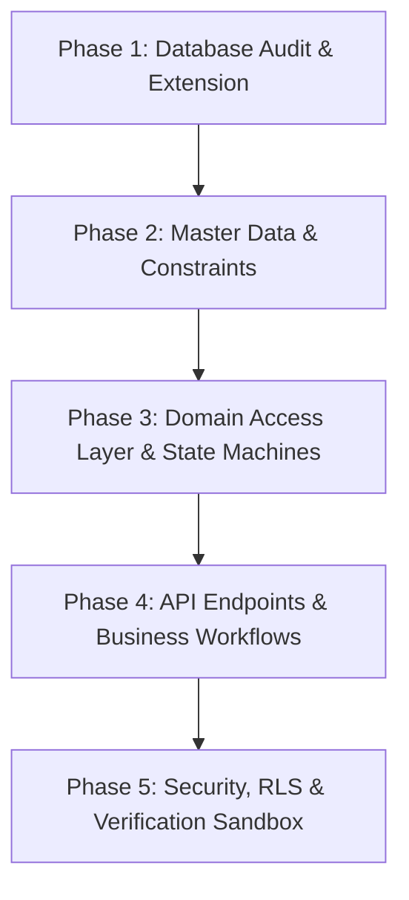

# Talentra Architecture & Implementation Guide
## Modules: Candidate Profile, Jobs & Employer Job Management, Applications & Hiring Pipeline

This guide outlines the system architecture, database validation against the live Neon PostgreSQL 18 instance, implementation plan, task breakdown, and executed migrations.

---

## 1. Executive Summary & Analysis

The specification in `Talentra_Profile_Jobs_Applications_Module.md` covers the primary talent acquisition and candidate matching core for Talentra.

### 1.1 Scope & Entity Breakdown
1. **Profile & Candidate Core (26 Entities):**
   - Core candidate profiles (`candidate_profile`, `candidate_contact`, `candidate_skill`, `candidate_education`, `candidate_subject`, `candidate_backlog`, `candidate_academic_result`, `candidate_experience`, `candidate_project`, `candidate_language`, `candidate_social_link`, `candidate_accomplishment`, `candidate_volunteer_experience`, `candidate_extracurricular_activity`, `candidate_document`).
   - Resumes & verifications (`resume_template`, `resume_version`, `education_verification`, `assessment_result`, `course_enrolment`, `profile_completion_score`).
   - Candidate activity & recruiter interest (`profile_view_history`, `candidate_activity_log`, `candidate_bookmark`, `candidate_bookmark_history`, `candidate_job_search_history`).
2. **Jobs & Employer Job Management (17 Entities):**
   - Organization job definitions (`organisation`, `job_requirement`, `job_location`, `job_qualification_requirement`, `job_skill_requirement`, `job_attachment`, `job_external_ats`, `job_position`).
   - Lifecycle, hiring workflows & eligibility (`job_status_history`, `job_application_policy`, `job_event`, `job_eligibility_policy`, `job_hiring_stage`, `job_academic_criterion`, `job_eligible_program`, `job_shortlist`, `shortlist_history`).
3. **Applications & Hiring Pipeline (16 Entities):**
   - Application submissions (`application`, `application_profile_snapshot`, `application_status_history`, `application_withdrawal`, `application_document`).
   - Dynamic questionnaires (`questionnaire`, `question`, `question_option`, `application_answer`).
   - Pipeline stages, evaluations & conversions (`application_stage_result`, `interview`, `offer`, `joining_record`, `candidate_job_eligibility_check`, `eligibility_check_result`, `referral_tracking`).
4. **Master Data & Shared Dependencies (44 Entities):**
   - Controlled domains, geography, localization, classifications, scoring, and user accounts.
5. **Government Identity Verification Extension (5 Entities):**
   - High-security normalized identity architecture for India and global regulatory compliance (`candidate_identity_document`, `identity_verification`, `identity_verification_attempt`, `identity_verification_consent`, `identity_verification_audit_log`).

---

## 2. Live Neon Database Audit vs. Specification

| Metric | Specification | Live Neon DB (`jolly-pond-45332483`) | Status |
| :--- | :--- | :--- | :--- |
| **Base Baseline Tables** | 103 tables | 103/103 tables present | Verified |
| **Government Identity Verification** | Proposed Extension | Deployed via Migration 001 (5 tables, 14 indexes, 7 triggers) | Completed |
| **Master Data Seeding** | Base ISO countries, currencies & ID types | Deployed via Migration 002 (ISO countries, currencies, PAN/Aadhaar/Passport types) | Completed |
| **Total Target Tables in Public** | 108 tables | Exactly 108 tables in `public` | Verified Clean |
| **Purged Redundant Entities** | Legacy & Extra Modules | 45 redundant tables in `public` + schemas `gig`, `organisation`, and `identity` dropped | Purged |
| **Stored Procedures / Triggers** | 5 core functions | All 5 present (`talentra_set_updated_at`, `talentra_reject_mutation`, `talentra_record_job_requirement_status`, `talentra_record_application_status`, `talentra_validate_answer`) | Verified |
| **Reference Code Integrity** | Strict domain linking | Every domain table has `reference_code_id NOT NULL` referencing `public.reference_code(id)` | Enforced |

---

## 3. Implementation Plan (Phased Roadmap)

### Phase 1: Database Baseline Reconciliation & Identity Extension (Executed)
- Audit all 103 baseline tables.
- Deploy normalized Government Identity Verification tables.
- Ensure all history and audit tables have append-only triggers (`talentra_reject_mutation`).

### Phase 2: Master Data Seeding & Referential Integrity (Executed)
- Seed geography (`country`, `state`, `city`).
- Seed specialized document types and verification statuses in both `reference_code` and domain tables.
- Verify foreign key trees and ON UPDATE/DELETE RESTRICT behaviors.

### Phase 3: Domain Data Access & State Machines
- Candidate Profile Domain: profile completeness calculation engine (0-100%), versioned resume uploads (SHA-256 integrity, private storage references).
- Job Requirement Domain: state machine transitions (`draft` -> `published` -> `paused` -> `closed` -> `cancelled`) with automated `job_status_history` capture.
- Application Pipeline Domain: atomic application creation with immutable `application_profile_snapshot` JSON capture.

### Phase 4: Business Rules & Questionnaire Engines
- Dynamic questionnaire validation via `application_answer` checking type constraints (`answer_text`, `answer_number`, `answer_date`, `answer_boolean`, `question_option_id`).
- Automated eligibility policy evaluation (`candidate_job_eligibility_check` against academic criteria, backlogs, and gap months).
- Offer lifecycle & joining record confirmation (`offer` -> `joining_record`).

### Phase 5: Security, KMS Encryption & Verification Integrations
- Envelope encryption (client-side / application KMS) for `document_number_ciphertext` and HMAC fingerprints.
- Masked display (`XXXX-XXXX-1234` for Aadhaar, `XXXXX1234X` for PAN).
- Provider webhook endpoints for asynchronous identity verification updates (`identity_verification_attempt`).

---

## 4. Task Breakdown (Task List)

| Task ID | Component | Description | Priority | Dependencies | Status |
| :--- | :--- | :--- | :--- | :--- | :--- |
| **T1** | Database | Audit 103 tables in live Neon DB | P0 | None | **DONE** |
| **T2** | Migration | Create & apply Government Identity Verification Extension | P0 | T1 | **DONE** |
| **T3** | Master Data | Seed ISO Countries, Currencies, and Identity Document Types | P0 | T2 | **DONE** |
| **T4** | Data Access | Setup Database Client / ORM / Schema types (TypeScript / SQL) | P1 | T3 | **NEXT** |
| **T5** | Candidate API | Profile CRUD, Contact E.164 validation, Education, Skills | P1 | T4 | Ready |
| **T6** | Resume Service | Resume Template & Versioned Resume with SHA-256 storage | P1 | T5 | Ready |
| **T7** | Job Service | Job creation, multi-city location, skills, academic policy | P1 | T4 | Ready |
| **T8** | Application Pipeline | Application apply flow + atomic profile snapshotting | P0 | T6, T7 | Ready |
| **T9** | Questionnaire Engine | Dynamic questionnaire definition and answer validation | P2 | T8 | Ready |
| **T10** | Identity Verification | KYC verification flow (Consent -> Encrypt -> Attempt -> Audit) | P1 | T2, T3 | Ready |

---

## 5. Executed Migrations

1. [001_government_identity_verification.sql](file:///d:/Talentra/migrations/001_government_identity_verification.sql):
   - Created `candidate_identity_document`, `identity_verification`, `identity_verification_attempt`, `identity_verification_consent`, `identity_verification_audit_log`.
   - Installed `talentra_set_updated_at` and `talentra_reject_mutation` triggers.
2. [002_seed_essential_master_data.sql](file:///d:/Talentra/migrations/002_seed_essential_master_data.sql):
   - Seeded ISO countries (`IN`, `US`, `GB`, `SG`, `AE`, `CA`, `AU`, `DE`).
   - Seeded currencies (`INR`, `USD`, `EUR`, `GBP`, `SGD`, `AED`).
   - Seeded specialized document types (`pan_card`, `aadhaar_card`, `passport`, `voter_id`, `driving_licence`) and verification statuses with full referential integrity.
