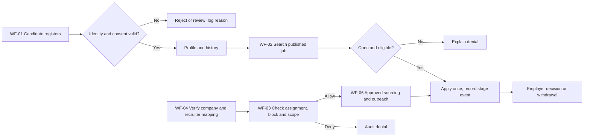
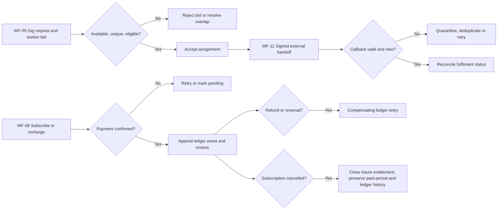
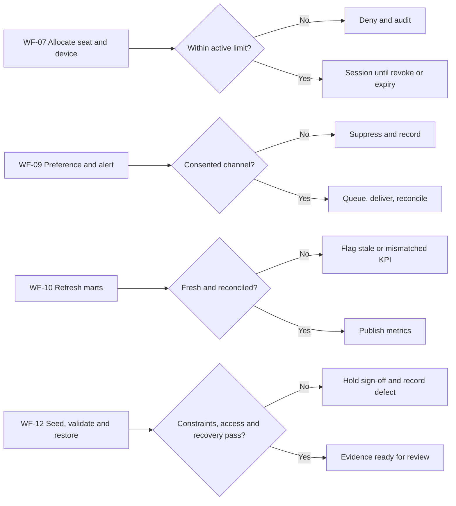

# 05 Output document — Business Workflow Analysis

## How the work moves

The workflows follow an event from the person or system that starts it to the record or decision it produces. They are written for a reviewer who needs to ask, “What happens if this is rejected, repeated, cancelled or delayed?” The diagrams below give the overview; these cards give the operating detail. They are intended behavior, not a claim that every path is implemented.

### WF-01 — Candidate creates and maintains a profile

**Trigger and actors:** A candidate (ACT-01) registers; the identity service and scheduled privacy process participate. **Steps:** verify uniqueness, record the candidate's consent/visibility choice, create the profile, attach skills and resume versions, then log later edits. **Decision:** is identity valid and is this use of data allowed? **Output:** one candidate identity with dated profile history. **Exceptions:** reject a duplicate; suppress use after consent withdrawal; route deletion requests through the retention/exception policy. This workflow covers FEAT-01.

### WF-02 — Employer posts a job and candidate applies

**Trigger and actors:** Employer (ACT-02) publishes a job; candidate (ACT-01) searches and applies. **Steps:** verify job is published and open, apply eligibility rules, create one active application, then append each allowed stage event. **Decision:** is the job still open and is the transition allowed? **Output:** a current application state with a readable history for both permitted parties. **Exceptions:** closed job or duplicate application is rejected atomically; withdrawal is recorded as a terminal event; a late employer update must not reopen a withdrawn application by accident. This covers FEAT-02.

### WF-03 — Recruiter or consultant requests access

**Trigger and actors:** Recruiter (ACT-03) or consultant (ACT-04) requests a candidate or job record; candidate (ACT-01) may have blocked the party; auditor (ACT-09) reviews evidence. **Steps:** resolve company, dated assignment, consultant-open status and block/consent state before returning data or permitting outreach. **Decision:** do all required scope checks pass now? **Output:** permitted read/action or denial with reason and actor. **Exceptions:** expired mapping, other-company access and blocked party are denied and audited. A recruiter cannot create a candidate registration. This covers FEAT-03.

### WF-04 — Organisation delegates recruiting work

**Trigger and actors:** Employer (ACT-02) or account admin (ACT-08) creates or changes a company and recruiter assignment; platform admin (ACT-14) handles a ticketed exception. **Steps:** verify the organisation, check hierarchy and effective dates, then create the mapping. **Decision:** is the company trusted and does this assignment overlap or create a cycle? **Output:** a dated, company-scoped assignment. **Exceptions:** reject invalid hierarchy and overlap while retaining the prior valid state. This covers FEAT-04.

### WF-05 — Gig request, bid and fulfilment

**Trigger and actors:** Requester (ACT-02) posts priced work; gig worker (ACT-06) states availability and bids; provider (ACT-10) reports external fulfilment. **Steps:** check open request and availability, accept one bid, create assignment, send a keyed handoff and reconcile the returned status. **Decision:** is the bid eligible and the callback valid and new? **Output:** assignment, fulfilment reference and final status, with rating where allowed. **Exceptions:** overlapping or repeat bid is rejected; a timeout stays pending and retries with the same key; duplicate/out-of-order results are reconciled, not applied twice. Cancellation records who cancelled and whether work or money had already moved. This covers FEAT-05 and FEAT-11.

### WF-06 — Sourcing request and outreach

**Trigger and actors:** Employer (ACT-02) opens a sourcing request; consultant (ACT-04) accepts or declines; recruiter (ACT-03) sends permitted outreach. **Steps:** verify open requirement, assignment and recipient eligibility, record the consultant decision, then enqueue a deduplicated message. **Decision:** may this actor contact this candidate for this job? **Output:** accepted/declined request and traceable outreach state. **Exceptions:** closed job, expired assignment, blocked candidate or duplicate recipient stops contact; provider failure follows WF-09 retry handling. This covers FEAT-06.

### WF-07 — Seat, device and session

**Trigger and actors:** Account admin (ACT-08) allocates a licence; user signs in; scheduled worker (ACT-11) expires sessions. **Steps:** check paid entitlement, allocate a seat, register permitted device, start a session and release it on expiry or revocation. **Decision:** are the active seat/device/session limits satisfied in the same transaction? **Output:** active or denied session with audit evidence. **Exceptions:** concurrent logins at the cap cannot both succeed; revocation terminates the session; a replacement device needs an explicit transition. This covers FEAT-07.

### WF-08 — Subscription, credit use, cancellation and refund

**Trigger and actors:** Employer (ACT-02) subscribes or recharges; gateway (ACT-10) confirms payment; account admin/support (ACT-08/12) handles a dispute. **Steps:** create pending order, verify keyed payment result, append a credit entry, debit for permitted use and issue invoice reference. **Decision:** was payment confirmed once, and is balance sufficient? **Output:** entitlement and append-only financial trail. **Exceptions:** a gateway timeout leaves the order pending for reconciliation; duplicate webhook makes no second credit; low balance denies use; cancellation records its effective date; refund writes a compensating event and preserves original payment. The immediate-versus-period-end entitlement policy needs owner approval. This covers FEAT-08.

### WF-09 — Preference, delivery and support

**Trigger and actors:** Candidate or employer (ACT-01/02) changes preferences; worker (ACT-11) sends an alert; provider (ACT-10) returns delivery status; support (ACT-12) handles failure. **Steps:** check channel consent, queue one message, send with stable key, record attempts and final result. **Decision:** is delivery permitted and should a retry occur? **Output:** delivered, suppressed or failed status visible to support without exposing unnecessary content. **Exceptions:** opt-out suppresses before send; duplicate callback is ignored; retry exhaustion moves to a review queue. This covers FEAT-09.

### WF-10 — Refresh and publish analytics

**Trigger and actors:** Scheduled worker (ACT-11) runs refresh; account/platform admin (ACT-08/14) reads scoped reports. **Steps:** collect source events, calculate dated funnel and finance aggregates, reconcile totals and publish a refresh marker. **Decision:** are data age and totals inside the accepted thresholds? **Output:** dated metrics with source and refresh IDs. **Exceptions:** late event triggers recomputation; mismatch or stale mart is flagged rather than silently presented as current. This covers FEAT-10.

### WF-11 — Receive an external callback

**Trigger and actors:** Payment, message or fulfilment provider (ACT-10) sends a result; worker (ACT-11) reconciles it. **Steps:** verify signature and provider reference, store raw-safe audit metadata, deduplicate by stable event key, check allowed state transition, then update the relevant workflow. **Decision:** trusted, new and in order? **Output:** one applied business event or a quarantined/ignored callback. **Exceptions:** invalid signature is rejected; provider outage retries with backoff; out-of-order events await reconciliation. This covers FEAT-11 across WF-05, 08 and 09.

### WF-12 — Build and validate evidence

**Trigger and actors:** Database engineer (ACT-16) runs the synthetic load; auditor (ACT-09) and operations reviewers inspect results. **Steps:** seed the target counts, check distributions and constraints, run fixed queries, test roles under distinct principals, then restore an isolated backup. **Decision:** do counts, access, performance and recovery evidence meet approved criteria? **Output:** reproducible report or a held gate with named failures. **Exceptions:** capacity ceiling, skew, failed constraint, missing access proof or slow restore is recorded with exact environment and rerun steps. This covers FEAT-12; Gate G1 remains open until review.

The cards cover all twelve must-have feature groups. Cancellation is explicit in WF-02, 05 and 08; refund in WF-08; retry and timeout in WF-05, 08, 09 and 11. The [shared catalogue](../nfr-workflows.md) holds the compact trace table.

## Candidate, job and controlled sourcing

## Gig, money and external handoff

## Sessions, communications and evidence

## Exception catalogue and test intent

| WF | Trigger or failure | Response and evidence | Test intent |
| --- | --- | --- | --- |
| 01 | Duplicate identity, consent withdrawn | Reject duplicate; stop disallowed processing and audit request | Unique identity and consent-state test |
| 02 | Closed job, duplicate apply, illegal stage | Reject transition atomically; preserve event history | State-machine and uniqueness test |
| 03 | Cross-company, stale assignment, block | Deny before contact; audit actor and reason | Two-account/blocked-party test |
| 04 | Hierarchy cycle or overlapping mapping | Reject invalid mapping; retain prior state | Constraint and date-overlap test |
| 05 | Overlap, repeat bid, provider timeout | Reject invalid bid; retry handoff with stable key | Concurrency and idempotency test |
| 06 | Job closed to consultant or stale recruiter | Reject sourcing/outreach; audit denial | Scope and duplicate-recipient test |
| 07 | Seat cap race or revoked device | Enforce cap transactionally; terminate revoked session | Concurrent-login test |
| 08 | Duplicate webhook, refund, low balance | Apply once; compensate with new ledger entry | Replayed-callback and balance test |
| 08 | Subscription cancellation during paid period | Stop renewal, record effective end and entitlement decision; preserve original payment and any refund as separate events | Cancel-at-period-end and immediate-cancel tests |
| 09 | Opt-out or delivery exhaustion | Suppress or dead-letter; keep privacy-safe evidence | Preference and retry test |
| 10 | Late source event or wrong mart total | Mark stale; reconcile to source before publish | Refresh/funnel reconciliation test |
| 11 | Bad signature, duplicate/out-of-order callback | Quarantine or ignore idempotently; reconcile provider state | Callback-order and trust test |
| 12 | Capacity, constraint or restore failure | Hold gate and record exact environment/failure | Seed quality, role and restore test |

Reviewers still need to decide who owns several exception policies and to verify diagram states against implemented contracts. The [decision register](../decisions-and-gaps.md) keeps G1 open pending that review.
