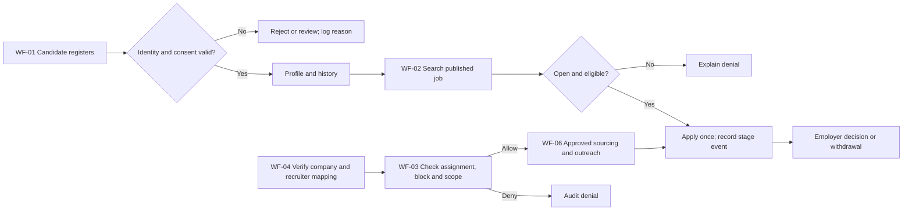
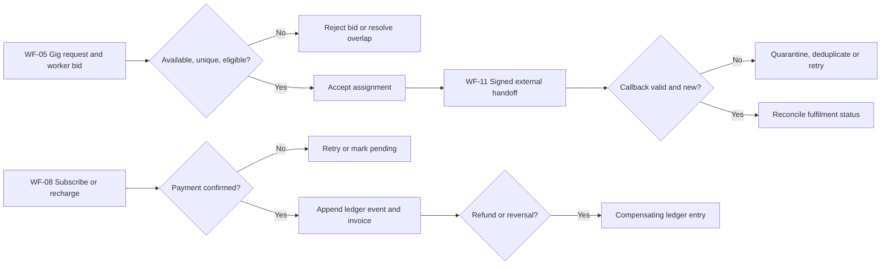
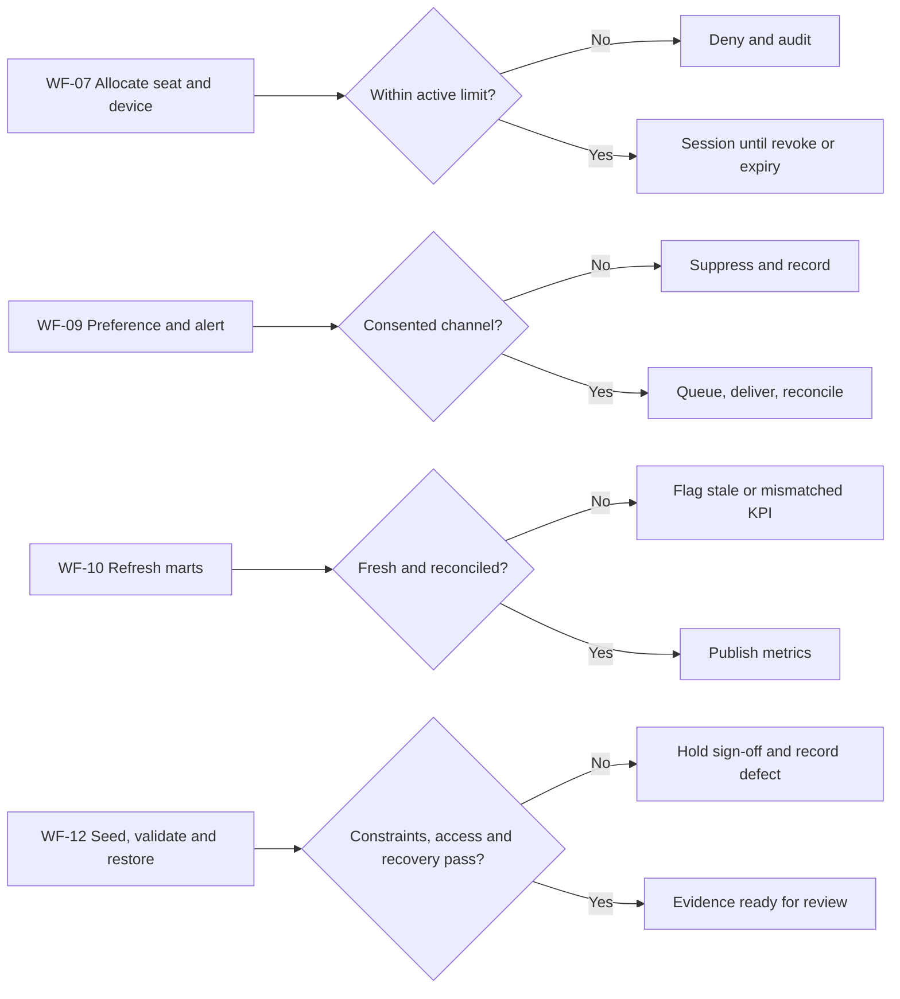

# 05 Output document — Business Workflow Analysis

The [WF-01–12 catalogue](../nfr-workflows.md) is the authoritative trigger, actor, core flow and failure-path inventory. Together with the [FEAT-01–12 inventory](../actors-goals-features.md), it maps every must-have capability to a workflow. These diagrams expose the main handoffs and decisions; the exception table below defines recovery intent.

## Candidate, job and controlled sourcing

## Gig, money and external handoff

## Sessions, communications and evidence

## Exception catalogue and test intent

| WF | Trigger or failure | Response and evidence | Test intent |
| --- | --- | --- | --- |
| 01 | Duplicate identity, consent withdrawn | Reject duplicate; stop disallowed processing and audit request | Unique identity and consent-state test |
| 02 | Closed job, duplicate apply, illegal stage | Reject transition atomically; preserve event history | State-machine and uniqueness test |
| 03 | Cross-company, stale assignment, block | Deny before contact; audit actor and reason | Two-account/blocked-party test |
| 04 | Hierarchy cycle or overlapping mapping | Reject invalid mapping; retain prior state | Constraint and date-overlap test |
| 05 | Overlap, repeat bid, provider timeout | Reject invalid bid; retry handoff with stable key | Concurrency and idempotency test |
| 06 | Job closed to consultant or stale recruiter | Reject sourcing/outreach; audit denial | Scope and duplicate-recipient test |
| 07 | Seat cap race or revoked device | Enforce cap transactionally; terminate revoked session | Concurrent-login test |
| 08 | Duplicate webhook, refund, low balance | Apply once; compensate with new ledger entry | Replayed-callback and balance test |
| 09 | Opt-out or delivery exhaustion | Suppress or dead-letter; keep privacy-safe evidence | Preference and retry test |
| 10 | Late source event or wrong mart total | Mark stale; reconcile to source before publish | Refresh/funnel reconciliation test |
| 11 | Bad signature, duplicate/out-of-order callback | Quarantine or ignore idempotently; reconcile provider state | Callback-order and trust test |
| 12 | Capacity, constraint or restore failure | Hold gate and record exact environment/failure | Seed quality, role and restore test |

Reviewers still need to decide who owns several exception policies and to verify diagram states against implemented contracts. The [decision register](../decisions-and-gaps.md) keeps G1 open pending that review.
