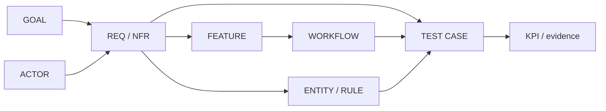

# Discovery pack — playbook steps 01–05

**Source hierarchy:** the [Talentra docket](../../sources/Talentra-Database-Design-Hackathon-Docket.pdf) states the project obligations; the [playbook](../../sources/Talencia%20Global%20-%20Data-Driven%20Development%20Lifecycle%20-%20Detailed%20Playbook.pdf) supplies the method; the [student notes](../../sources/Premium-Talent-Accelerator-Program-Student-Learning-Notes.pdf) supply review practices. The notes' imagined 1,350 tables/155 million rows and coaching score bands are examples, not Talentra acceptance targets.

## Artifact schema

An ID is stable within this pack. `REQ` is required behavior, `NFR` a measurable quality target, `ACT` an actor, `GOAL` a business outcome, `FEAT` a capability, `WF` a workflow, and `TC` a test intent. `Source` identifies the docket section or an explicit team proposal. `Observed` means checked against a repository artifact or live Neon; `planned` is not proof. No source-derived statement is silently converted into a product promise.

| Step | Output schema | Schema scorecard | Output document | Open review |
| --- | --- | --- | --- | --- |
| 01 Requirement analysis | [Schema](01-requirements/output-schema.md) | [Scorecard](01-requirements/schema-rating-scorecard.md) | [Document](01-requirements/output-document.md) | Sentence-level docket and Tier 2/rule audit |
| 02 Stakeholders and roles | [Schema](02-stakeholders/output-schema.md) | [Scorecard](02-stakeholders/schema-rating-scorecard.md) | [Document](02-stakeholders/output-document.md) | TPO, guest, admin and blocked-party permissions |
| 03 Feature discovery | [Schema](03-features/output-schema.md) | [Scorecard](03-features/schema-rating-scorecard.md) | [Document](03-features/output-document.md) | Field-level coverage and owner acceptance |
| 04 NFR discovery | [Schema](04-nfr/output-schema.md) | [Scorecard](04-nfr/schema-rating-scorecard.md) | [Document](04-nfr/output-document.md) | Numeric proposals and retention period |
| 05 Workflow analysis | [Schema](05-workflows/output-schema.md) | [Scorecard](05-workflows/schema-rating-scorecard.md) | [Document](05-workflows/output-document.md) | Exception ownership and state transitions |

Use [master.txt](master.txt) to present the five steps and their decisions to the head of team.
The [spreadsheet index](spreadsheets/README.md) links to all 15 Excel `.xls` versions of these documents. Download the [complete ZIP](spreadsheets/stage1-spreadsheets.zip) to review them together; each workbook has an Overview sheet and separate filterable table sheets.
Open the [interactive discovery map](discovery-visual.html) for a browser presentation. The [18-requirement bubble graph](requirement-graph.html) connects each requirement to its docket source, directly named actors, related workflow actors, feature and workflow. The [graphical database schema](schema-hierarchy.html) shows the separate physical hierarchy: database, five schemas, tables and columns, with a foreign-key relationship view. Its catalog was captured from the local `talentra_local` database on 22 October 2026; it is an offline snapshot, not a live DBeaver connection or Neon production. The map's deliverable links open the [formatted document viewer](discovery-documents.html), which works offline and includes the 15 step artifacts plus supporting registers. The [six-page PDF handout](discovery-visual.pdf) is a static copy. After editing a Markdown source, regenerate the viewer with `python3 lifecycle/01-discover/build_discovery_viewer.py` and the bubble graph with `python3 lifecycle/01-discover/build_requirement_graph.py`. After refreshing `schema-catalog.json` from the read-only `schema-catalog.sql`, regenerate the schema page with `python3 lifecycle/01-discover/build_schema_hierarchy.py`.
For a live database demonstration, use the [DBeaver hierarchy walkthrough](dbeaver-hierarchy.md) and its [read-only SQL](dbeaver-presentation.sql).

The [test-case graph](test-case-graph.md) gives a reviewable first two levels and representative leaves, as recommended by the student notes. [Decisions and gaps](decisions-and-gaps.md) records conflicts and gate status. All fifteen requested Stage 1 files are prepared; **G1 is open** until the unresolved items there are decided and independently reviewed. The [form evidence](stage1-form-evidence.md) separates document production from gate acceptance.
