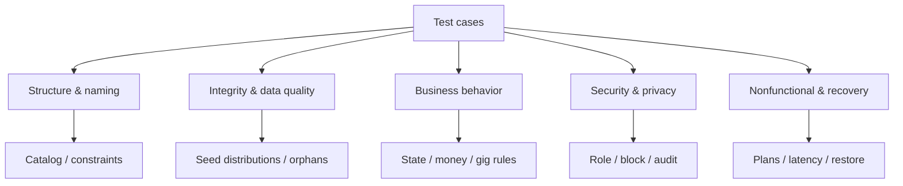

# Test-case graph (working schema)

The student notes recommend showing the first two levels before expanding leaves, then testing the graph against actual data. This graph is a test inventory, not a claim that cases pass. `TC` cases are intents for playbook step 15 and docket B65–B80; existing SQL suites must be mapped to them before marking coverage.

| ID | Branch | Requirement/NFR | Representative assertion | Evidence status |
| --- | --- | --- | --- | --- |
| TC-01 | Structure | REQ-01–13 | Tables, keys and constraint naming match approved model | Prior phase catalog exports; full compliance audit open |
| TC-02 | Integrity | REQ-01/02, NFR-05 | Seed has no orphan applications or invalid FK constraints | 2026-10-16 report: 0 each; repeat after new load |
| TC-03 | Integrity | REQ-01, NFR-01 | Multilingual names and duplicates have documented distributions; detail coverage measured | Partial seed report; detailed profile coverage open |
| TC-04 | Behavior | REQ-02 | Illegal application transitions rejected; all allowed transitions reachable | Open |
| TC-05 | Behavior | REQ-07 | Same gig worker cannot hold overlapping accepted assignments | Test-branch suite exists; production check open |
| TC-06 | Behavior | REQ-09 | Concurrent login at device cap admits only allowed sessions | Open |
| TC-07 | Behavior | REQ-10 | Refund creates compensating ledger entry; duplicate webhook makes no second credit | Open |
| TC-08 | Security | REQ-03–05, NFR-04 | Cross-account recruiter and blocked-party read/write denied and audited | Production behavior open |
| TC-09 | Security | REQ-01, NFR-10 | Retention/deletion process removes or masks candidate data within approved period | Policy and test open |
| TC-10 | Nonfunctional | REQ-14, NFR-03/07 | Twelve fixed queries run; top ten plans and p50/p95/p99 saved at declared size | Open |
| TC-11 | Nonfunctional | REQ-12, NFR-08 | Mart refresh totals reconcile after final seed | Open; current funnel mart only 10 rows |
| TC-12 | Recovery | REQ-14, NFR-06 | Isolated restore meets accepted RTO/RPO | Target acceptance and exercise open |

Review this classification against the actual SQL suites and production catalog. Split branches only where a distinction changes test ownership or evidence; more diagram nodes alone do not prove quality.
