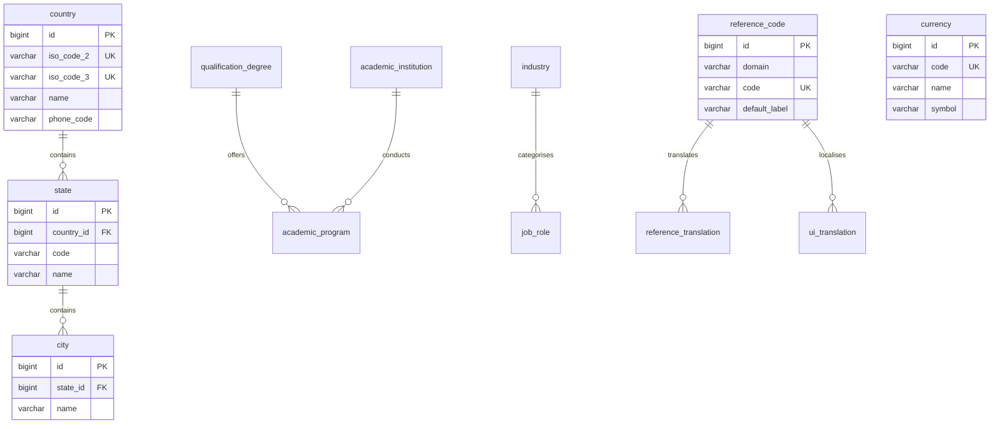
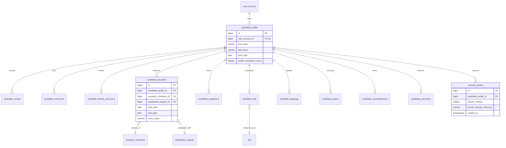
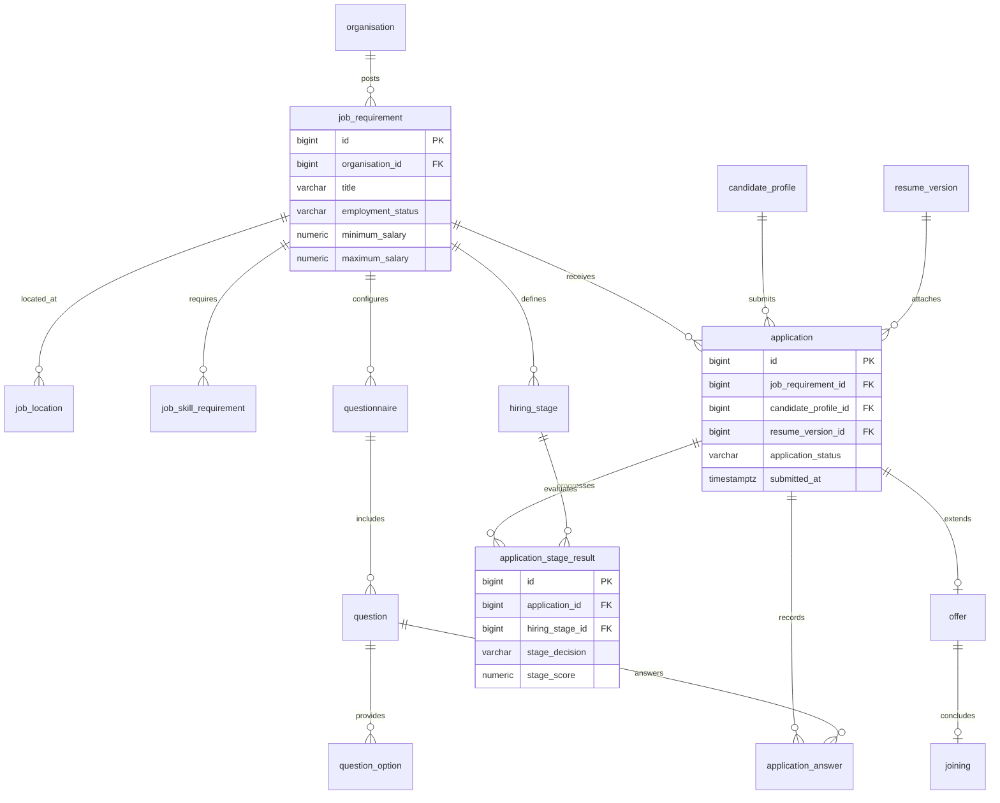

# Talentra Phase 1: Entity Relationships & ER Diagrams

This document details the relational architecture, foreign key constraints, and entity diagrams for Modules 1, 2, and 3 (Phase 1 Foundation). Complete tabular foreign key definitions are catalogued in [relationships.csv](docs/relationships.csv).

---

## 1. Module 1: Master Data & Global Lookups

The master data module establishes standardized ISO references for geographies (countries, administrative states, cities), official currencies, languages, industries, job roles, skills, and multilingual lookup codes. All reference tables provide natural uniqueness keys and link through `reference_code` to support multi-language localizations.

---

## 2. Module 2: Candidate Profile & Experience

The candidate profile module anchors candidate personal data, educational credentials, work histories, verified skills, and multimedia portfolio projects. Resumes are stored as immutable, incrementing versions referencing private encrypted cloud object storage. Academic scores enforce valid grading scales and institution cross-references.

---

## 3. Module 3: Jobs and Applications Pipeline

The job and application pipeline governs the full recruitment lifecycle:
1. **Job Definition**: Requirements, multi-location assignments, mandatory skills, customizable hiring workflow stages, and dynamic candidate screening questionnaires.
2. **Application Processing**: One application per candidate per job requirement. Applications enforce composite ownership: candidate resume versions must belong to the applying candidate, and questionnaire answers must correspond to questions of the target job requirement.
3. **Pipeline Progress**: Sequential stage transitions append immutable history. Accepted candidates receive formalized offers leading to verified onboarding joinings.

---

## 4. Referential & Constraint Summary

- **Foreign Key Actions**: All foreign keys strictly enforce `ON UPDATE RESTRICT ON DELETE RESTRICT`. No cascading deletes of candidate history, educational records, or job applications are permitted.
- **Audit Columns**: Every table includes `created_at`, `created_by`, `updated_at`, `updated_by`, and `deleted_at`.
- **Primary Keys**: 64-bit `BIGINT GENERATED ALWAYS AS IDENTITY`.
- **Soft Deletion**: Logical deletions set `deleted_at`; immutable snapshots and event histories reject mutations outright via trigger guards.
