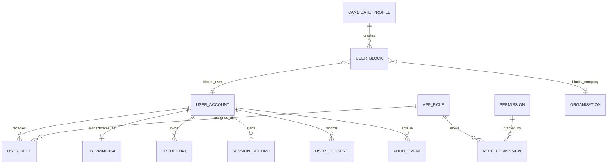
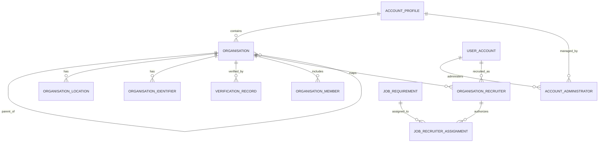
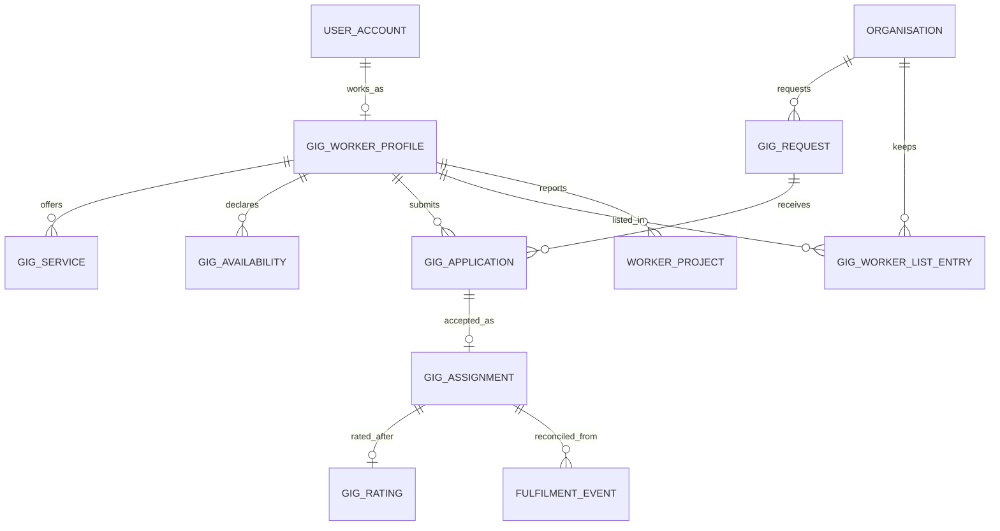

# Phase 2 relationship models

These diagrams show the main links for B27–B29. [relationships.csv](docs/relationships.csv) contains every installed foreign key, including the composite ownership keys.

## Administration (B27)

`DB_PRINCIPAL` maps one database login role to one account. The role/permission and user/role joins decide access at query time. A user block has exactly one target: another account or an organisation.

## Organisation and account (B28)

Parent and child organisations share an account. A job assignment points to both its job's organisation and the same recruiter's active company mapping. Effective-dated intervals are half-open and cannot overlap for the same subject.

## Gig marketplace (B29)

Workers submit applications to requester-created gigs. A single accepted application may become one assignment. The assignment stores the same worker, request and exact time window as its parents, and worker assignment windows cannot overlap.
