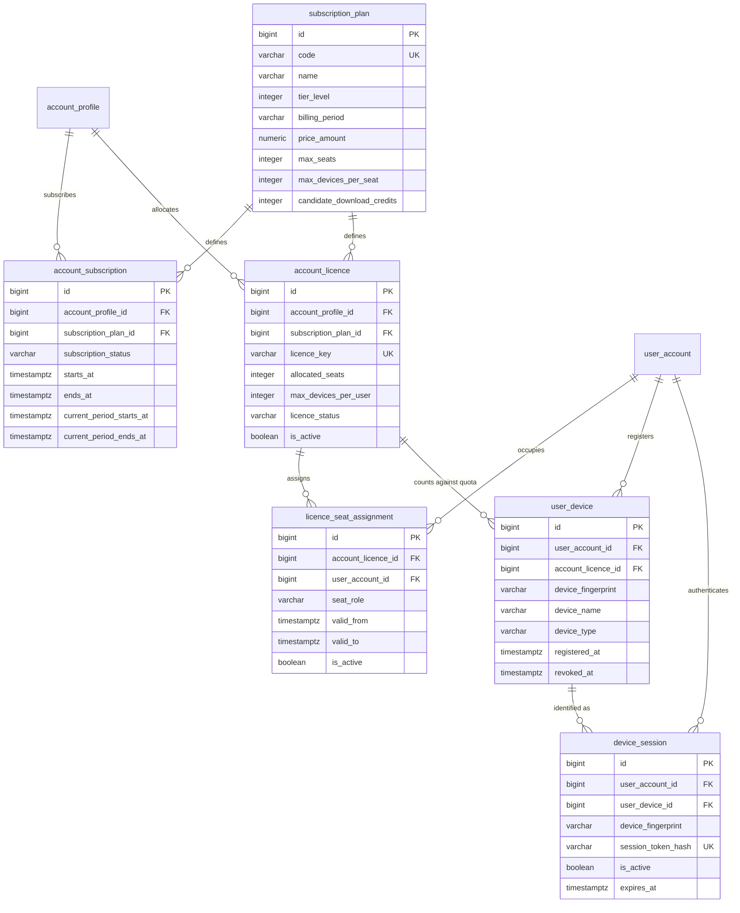
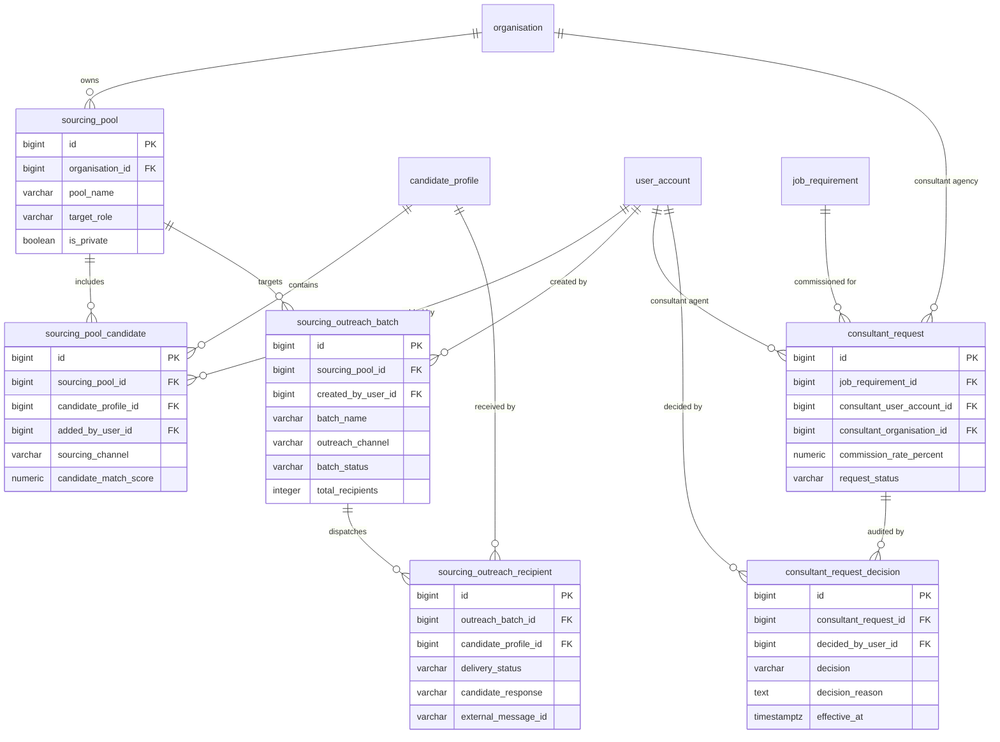
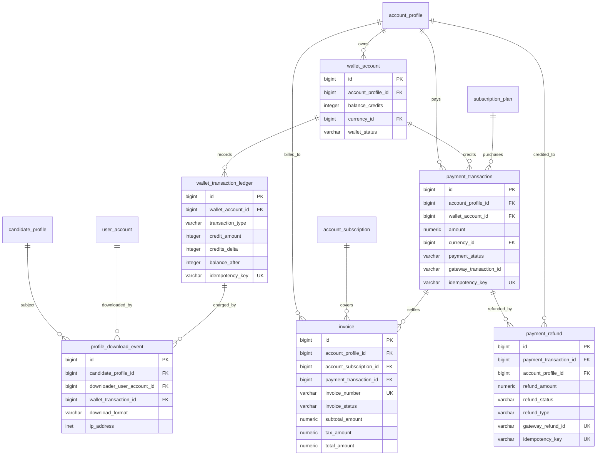

# Talentra Phase 3: Entity Relationships & ER Diagrams

This document details the relational architecture, foreign key constraints, and entity diagrams for Modules 7, 8, and 9 (Phase 3) incorporating the 6 gap closure entities deployed under **B36–B47**.

---

## 1. Module 7: Plans, Licences, Seats, Devices & Sessions

---

## 2. Module 8: Sourcing, Outreach Campaigns & Consultant Mandates

---

## 3. Module 9: Billing, Invoices, Refunds & Financial Ledger

