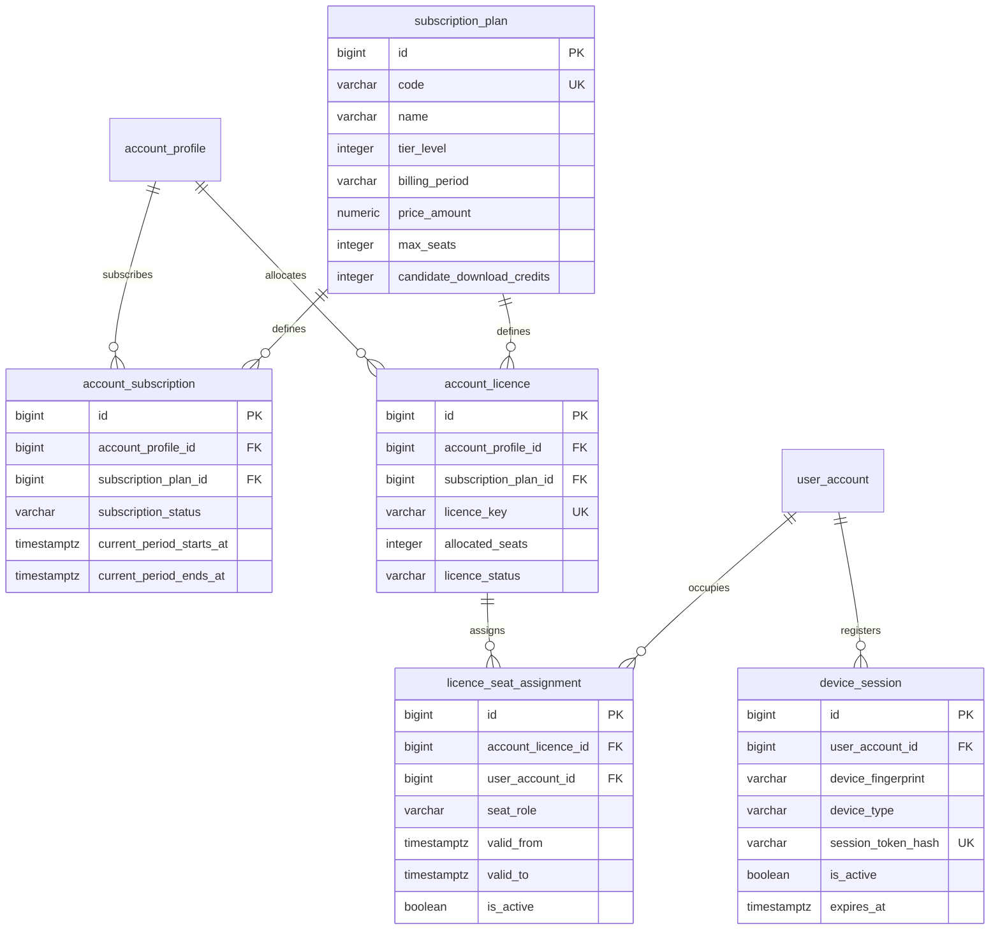
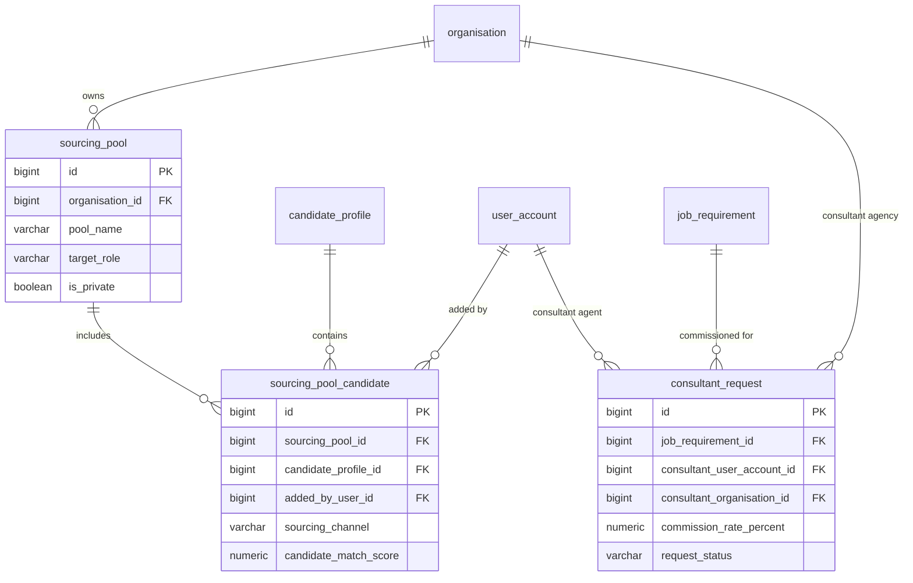
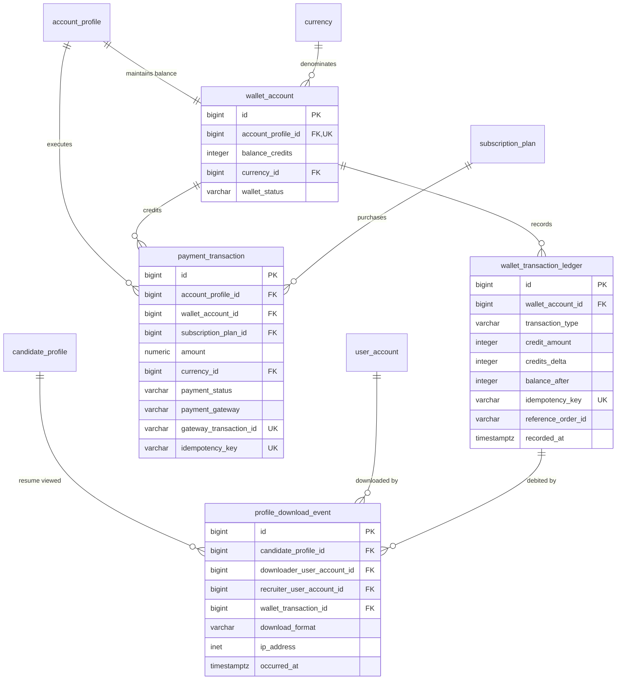

# Talentra Phase 3: Entity Relationships & ER Diagrams

This document details the relational architecture, foreign key constraints, and entity diagrams for Modules 7, 8, and 9 (Phase 3).

---

## 1. Module 7: Plans, Licences, Seats, Devices & Sessions

---

## 2. Module 8: Sourcing, Consultant Requests & Recruiter Workflows

---

## 3. Module 9: Subscriptions, Wallets, Payments & Ledger

---

## 4. Integrity and Immutability Controls

1. **Non-Overlapping Active Seats**:
   Seat allocations prevent concurrent active assignments for the same licence and user.
2. **Append-Only Financial Ledger**:
   `public.wallet_transaction_ledger` enforces append-only semantics via the `talentra_reject_mutation()` trigger, preventing unauthorized updates or deletions.
3. **Download Traceability**:
   `public.profile_download_event` links every resume export event to the candidate profile, downloading recruiter, client IP address, and ledger debit transaction.
4. **Transaction Idempotency**:
   Unique indexes on `idempotency_key` prevent duplicate payment processing or duplicate credit allocations from webhook retries.
