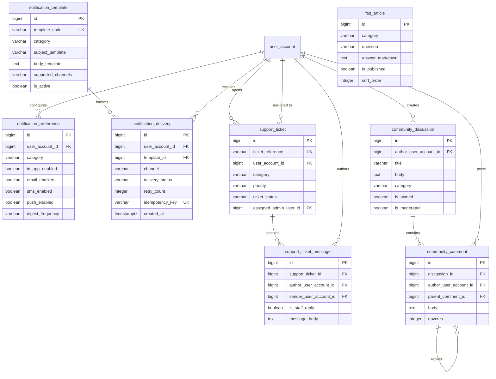
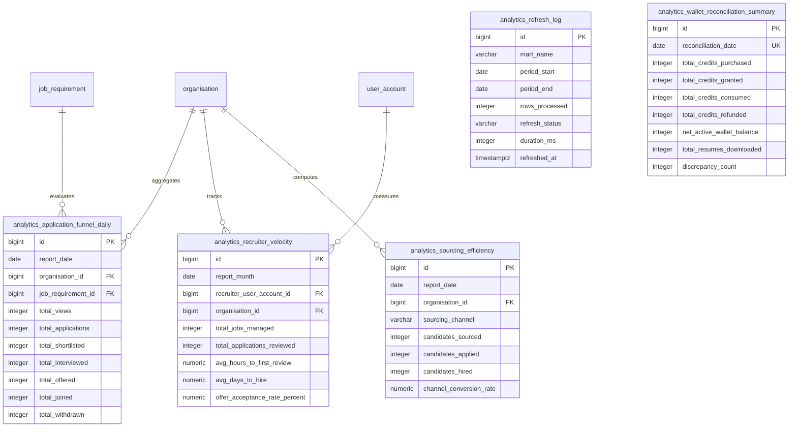

# Talentra Phase 4: Entity Relationships & ER Diagrams

This document details the relational architecture, foreign key constraints, and entity diagrams for Modules 10 and 11 (Phase 4).

---

## 1. Module 10: Notifications, Preferences & Community

---

## 2. Module 11: Analytics Layer & Reporting Data Marts

---

## 3. Cross-Module Reporting Integrity

1. **Analytical Rollup Boundaries**:
   Reporting marts summarize core transaction records without duplicating sensitive personally identifiable information (PII). All personal candidate data remains protected under Module 2 constraints.
2. **Composite Uniqueness**:
   Daily rollup tables enforce composite unique keys (e.g., `report_date + organisation_id + job_requirement_id`) to ensure that scheduled refresh jobs are strictly idempotent and prevent duplicate metrics.
3. **Audit Trail Synchronization**:
   Every analytical pipeline execution writes to `analytics_refresh_log`, capturing duration in milliseconds and row throughput to detect stale caches or data pipeline delays.
